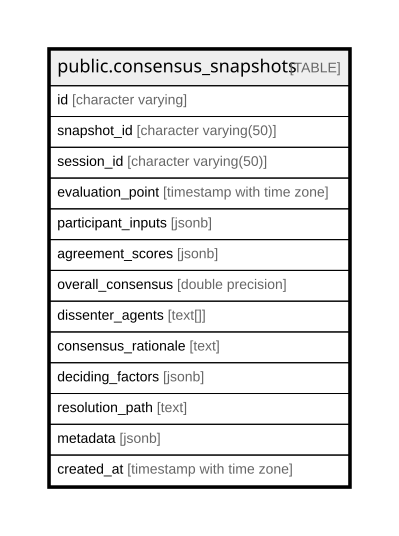

# public.consensus_snapshots

## Columns

| Name | Type | Default | Nullable | Children | Parents | Comment |
| ---- | ---- | ------- | -------- | -------- | ------- | ------- |
| id | character varying | gen_random_uuid() | false |  |  |  |
| snapshot_id | character varying(50) |  | false |  |  |  |
| session_id | character varying(50) |  | false |  |  |  |
| evaluation_point | timestamp with time zone |  | false |  |  |  |
| participant_inputs | jsonb |  | false |  |  |  |
| agreement_scores | jsonb |  | false |  |  |  |
| overall_consensus | double precision |  | false |  |  |  |
| dissenter_agents | text[] | ARRAY[]::text[] | true |  |  |  |
| consensus_rationale | text |  | true |  |  |  |
| deciding_factors | jsonb |  | true |  |  |  |
| resolution_path | text |  | true |  |  |  |
| metadata | jsonb |  | true |  |  |  |
| created_at | timestamp with time zone | now() | false |  |  |  |

## Viewpoints

| Name | Definition |
| ---- | ---------- |
| [public schema](viewpoint-schema-public.md) | All mapped relations in public. |

## Constraints

| Name | Type | Definition |
| ---- | ---- | ---------- |
| consensus_snapshots_pkey | PRIMARY KEY | PRIMARY KEY (id) |
| consensus_snapshots_snapshot_id_key | UNIQUE | UNIQUE (snapshot_id) |

## Indexes

| Name | Definition |
| ---- | ---------- |
| consensus_snapshots_evaluation_point_idx | CREATE INDEX consensus_snapshots_evaluation_point_idx ON public.consensus_snapshots USING btree (evaluation_point) |
| consensus_snapshots_pkey | CREATE UNIQUE INDEX consensus_snapshots_pkey ON public.consensus_snapshots USING btree (id) |
| consensus_snapshots_session_id_idx | CREATE INDEX consensus_snapshots_session_id_idx ON public.consensus_snapshots USING btree (session_id) |
| consensus_snapshots_snapshot_id_idx | CREATE INDEX consensus_snapshots_snapshot_id_idx ON public.consensus_snapshots USING btree (snapshot_id) |
| consensus_snapshots_snapshot_id_key | CREATE UNIQUE INDEX consensus_snapshots_snapshot_id_key ON public.consensus_snapshots USING btree (snapshot_id) |

## Relations

---

> Generated by [tbls](https://github.com/k1LoW/tbls)
