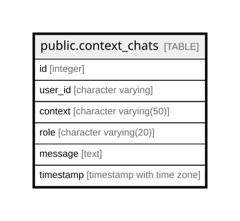

# public.context_chats

## Columns

| Name | Type | Default | Nullable | Children | Parents | Comment |
| ---- | ---- | ------- | -------- | -------- | ------- | ------- |
| id | integer | nextval('context_chats_id_seq'::regclass) | false |  |  |  |
| user_id | character varying |  | false |  |  |  |
| context | character varying(50) |  | false |  |  |  |
| role | character varying(20) |  | false |  |  |  |
| message | text |  | false |  |  |  |
| timestamp | timestamp with time zone | now() | true |  |  |  |

## Viewpoints

| Name | Definition |
| ---- | ---------- |
| [public schema](viewpoint-schema-public.md) | All mapped relations in public. |

## Constraints

| Name | Type | Definition |
| ---- | ---- | ---------- |
| context_chats_pkey | PRIMARY KEY | PRIMARY KEY (id) |

## Indexes

| Name | Definition |
| ---- | ---------- |
| context_chats_pkey | CREATE UNIQUE INDEX context_chats_pkey ON public.context_chats USING btree (id) |

## Relations

---

> Generated by [tbls](https://github.com/k1LoW/tbls)
