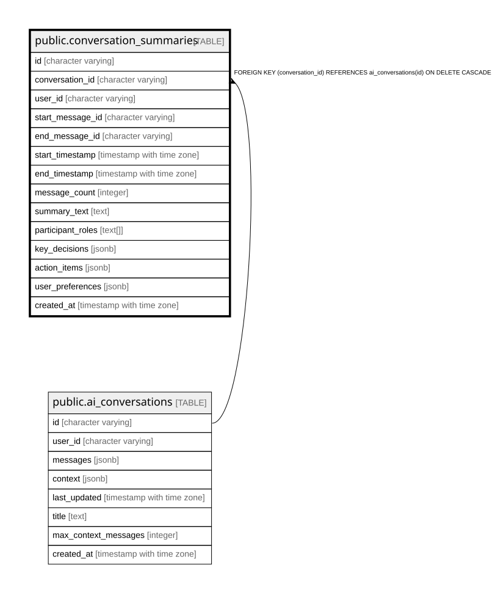

# public.conversation_summaries

## Columns

| Name | Type | Default | Nullable | Children | Parents | Comment |
| ---- | ---- | ------- | -------- | -------- | ------- | ------- |
| id | character varying | gen_random_uuid() | false |  |  |  |
| conversation_id | character varying |  | false |  | [public.ai_conversations](public.ai_conversations.md) |  |
| user_id | character varying |  | false |  |  |  |
| start_message_id | character varying |  | true |  |  |  |
| end_message_id | character varying |  | true |  |  |  |
| start_timestamp | timestamp with time zone |  | false |  |  |  |
| end_timestamp | timestamp with time zone |  | false |  |  |  |
| message_count | integer |  | false |  |  |  |
| summary_text | text |  | false |  |  |  |
| participant_roles | text[] | ARRAY['user'::text, 'assistant'::text, 'system'::text] | true |  |  |  |
| key_decisions | jsonb |  | true |  |  |  |
| action_items | jsonb |  | true |  |  |  |
| user_preferences | jsonb |  | true |  |  |  |
| created_at | timestamp with time zone | now() | true |  |  |  |

## Viewpoints

| Name | Definition |
| ---- | ---------- |
| [public schema](viewpoint-schema-public.md) | All mapped relations in public. |

## Constraints

| Name | Type | Definition |
| ---- | ---- | ---------- |
| conversation_summaries_conversation_id_ai_conversations_id_fk | FOREIGN KEY | FOREIGN KEY (conversation_id) REFERENCES ai_conversations(id) ON DELETE CASCADE |
| conversation_summaries_pkey | PRIMARY KEY | PRIMARY KEY (id) |

## Indexes

| Name | Definition |
| ---- | ---------- |
| conversation_summaries_conversation_id_idx | CREATE UNIQUE INDEX conversation_summaries_conversation_id_idx ON public.conversation_summaries USING btree (conversation_id, created_at) |
| conversation_summaries_pkey | CREATE UNIQUE INDEX conversation_summaries_pkey ON public.conversation_summaries USING btree (id) |

## Relations

---

> Generated by [tbls](https://github.com/k1LoW/tbls)
