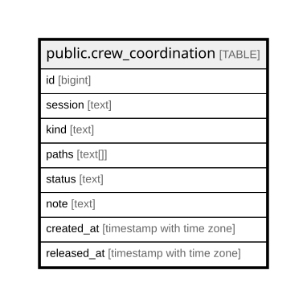

# public.crew_coordination

## Description

B-CREW-COORD #554: cross-session claim/push board. Visibility + serialization, NOT atomicity (Langston 2026-07-22). No trading-path code may read this table.

## Columns

| Name | Type | Default | Nullable | Children | Parents | Comment |
| ---- | ---- | ------- | -------- | -------- | ------- | ------- |
| id | bigint | nextval('crew_coordination_id_seq'::regclass) | false |  |  |  |
| session | text |  | false |  |  |  |
| kind | text |  | false |  |  |  |
| paths | text[] | '{}'::text[] | false |  |  |  |
| status | text | 'active'::text | false |  |  |  |
| note | text |  | true |  |  |  |
| created_at | timestamp with time zone | now() | false |  |  |  |
| released_at | timestamp with time zone |  | true |  |  |  |

## Viewpoints

| Name | Definition |
| ---- | ---------- |
| [public schema](viewpoint-schema-public.md) | All mapped relations in public. |

## Constraints

| Name | Type | Definition |
| ---- | ---- | ---------- |
| crew_coordination_kind_chk | CHECK | CHECK (kind = ANY (ARRAY['claim'::text, 'push'::text])) |
| crew_coordination_pkey | PRIMARY KEY | PRIMARY KEY (id) |
| crew_coordination_release_chk | CHECK | CHECK (status = 'active'::text AND released_at IS NULL OR status <> 'active'::text AND released_at IS NOT NULL) |
| crew_coordination_status_chk | CHECK | CHECK (status = ANY (ARRAY['active'::text, 'released'::text, 'expired'::text])) |

## Indexes

| Name | Definition |
| ---- | ---------- |
| crew_coordination_active_idx | CREATE INDEX crew_coordination_active_idx ON public.crew_coordination USING btree (status, kind) WHERE (status = 'active'::text) |
| crew_coordination_one_active_push | CREATE UNIQUE INDEX crew_coordination_one_active_push ON public.crew_coordination USING btree (kind) WHERE ((kind = 'push'::text) AND (status = 'active'::text)) |
| crew_coordination_pkey | CREATE UNIQUE INDEX crew_coordination_pkey ON public.crew_coordination USING btree (id) |

## Relations

---

> Generated by [tbls](https://github.com/k1LoW/tbls)
