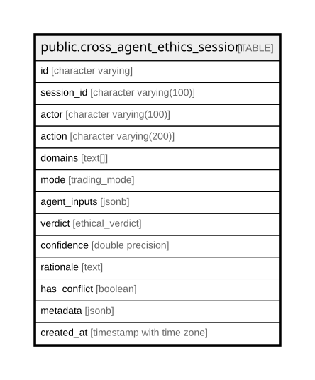

# public.cross_agent_ethics_session

## Columns

| Name | Type | Default | Nullable | Children | Parents | Comment |
| ---- | ---- | ------- | -------- | -------- | ------- | ------- |
| id | character varying | gen_random_uuid() | false |  |  |  |
| session_id | character varying(100) |  | false |  |  |  |
| actor | character varying(100) |  | false |  |  |  |
| action | character varying(200) |  | false |  |  |  |
| domains | text[] |  | false |  |  |  |
| mode | trading_mode |  | false |  |  |  |
| agent_inputs | jsonb |  | false |  |  |  |
| verdict | ethical_verdict |  | false |  |  |  |
| confidence | double precision |  | false |  |  |  |
| rationale | text |  | false |  |  |  |
| has_conflict | boolean | false | false |  |  |  |
| metadata | jsonb |  | true |  |  |  |
| created_at | timestamp with time zone | now() | false |  |  |  |

## Viewpoints

| Name | Definition |
| ---- | ---------- |
| [public schema](viewpoint-schema-public.md) | All mapped relations in public. |

## Constraints

| Name | Type | Definition |
| ---- | ---- | ---------- |
| cross_agent_ethics_session_pkey | PRIMARY KEY | PRIMARY KEY (id) |

## Indexes

| Name | Definition |
| ---- | ---------- |
| cross_agent_ethics_session_created_at_idx | CREATE INDEX cross_agent_ethics_session_created_at_idx ON public.cross_agent_ethics_session USING btree (created_at) |
| cross_agent_ethics_session_pkey | CREATE UNIQUE INDEX cross_agent_ethics_session_pkey ON public.cross_agent_ethics_session USING btree (id) |
| cross_agent_ethics_session_session_id_idx | CREATE INDEX cross_agent_ethics_session_session_id_idx ON public.cross_agent_ethics_session USING btree (session_id) |
| cross_agent_ethics_session_verdict_idx | CREATE INDEX cross_agent_ethics_session_verdict_idx ON public.cross_agent_ethics_session USING btree (verdict) |

## Relations

---

> Generated by [tbls](https://github.com/k1LoW/tbls)
