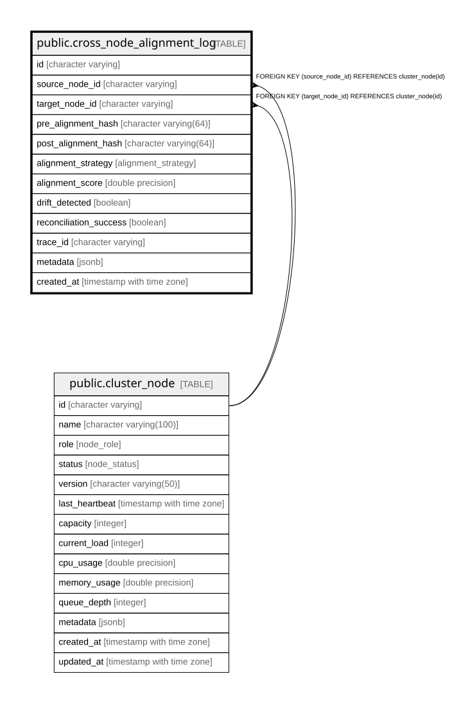

# public.cross_node_alignment_log

## Columns

| Name | Type | Default | Nullable | Children | Parents | Comment |
| ---- | ---- | ------- | -------- | -------- | ------- | ------- |
| id | character varying | gen_random_uuid() | false |  |  |  |
| source_node_id | character varying |  | false |  | [public.cluster_node](public.cluster_node.md) |  |
| target_node_id | character varying |  | false |  | [public.cluster_node](public.cluster_node.md) |  |
| pre_alignment_hash | character varying(64) |  | false |  |  |  |
| post_alignment_hash | character varying(64) |  | true |  |  |  |
| alignment_strategy | alignment_strategy |  | false |  |  |  |
| alignment_score | double precision | 0.0 | false |  |  |  |
| drift_detected | boolean | false | false |  |  |  |
| reconciliation_success | boolean | false | false |  |  |  |
| trace_id | character varying |  | false |  |  |  |
| metadata | jsonb |  | true |  |  |  |
| created_at | timestamp with time zone | now() | false |  |  |  |

## Viewpoints

| Name | Definition |
| ---- | ---------- |
| [public schema](viewpoint-schema-public.md) | All mapped relations in public. |

## Constraints

| Name | Type | Definition |
| ---- | ---- | ---------- |
| cross_node_alignment_log_pkey | PRIMARY KEY | PRIMARY KEY (id) |
| cross_node_alignment_log_source_node_id_fkey | FOREIGN KEY | FOREIGN KEY (source_node_id) REFERENCES cluster_node(id) |
| cross_node_alignment_log_target_node_id_fkey | FOREIGN KEY | FOREIGN KEY (target_node_id) REFERENCES cluster_node(id) |

## Indexes

| Name | Definition |
| ---- | ---------- |
| cross_node_alignment_log_created_at_idx | CREATE INDEX cross_node_alignment_log_created_at_idx ON public.cross_node_alignment_log USING btree (created_at) |
| cross_node_alignment_log_drift_detected_idx | CREATE INDEX cross_node_alignment_log_drift_detected_idx ON public.cross_node_alignment_log USING btree (drift_detected) |
| cross_node_alignment_log_pkey | CREATE UNIQUE INDEX cross_node_alignment_log_pkey ON public.cross_node_alignment_log USING btree (id) |
| cross_node_alignment_log_source_node_id_idx | CREATE INDEX cross_node_alignment_log_source_node_id_idx ON public.cross_node_alignment_log USING btree (source_node_id) |
| cross_node_alignment_log_target_node_id_idx | CREATE INDEX cross_node_alignment_log_target_node_id_idx ON public.cross_node_alignment_log USING btree (target_node_id) |
| cross_node_alignment_log_trace_id_idx | CREATE INDEX cross_node_alignment_log_trace_id_idx ON public.cross_node_alignment_log USING btree (trace_id) |

## Relations

---

> Generated by [tbls](https://github.com/k1LoW/tbls)
