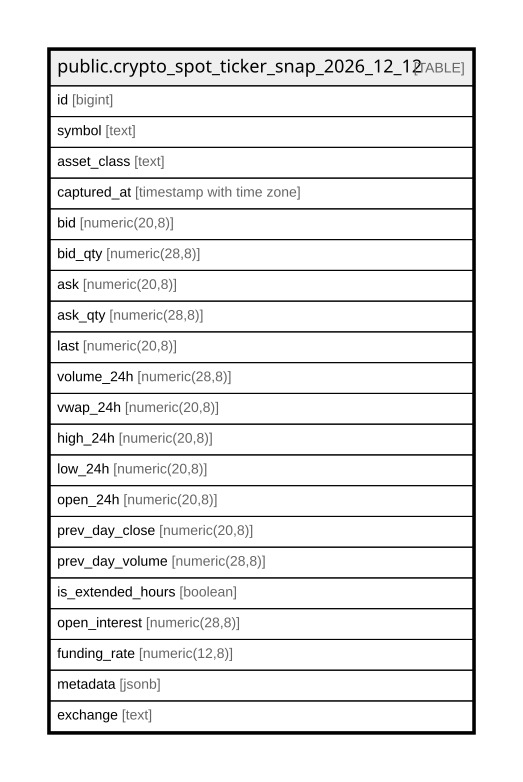

# public.crypto_spot_ticker_snap_2026_12_12

## Columns

| Name | Type | Default | Nullable | Children | Parents | Comment |
| ---- | ---- | ------- | -------- | -------- | ------- | ------- |
| id | bigint | nextval('crypto_spot_ticker_snap_id_seq'::regclass) | false |  |  |  |
| symbol | text |  | false |  |  |  |
| asset_class | text | 'crypto_spot'::text | false |  |  |  |
| captured_at | timestamp with time zone |  | false |  |  |  |
| bid | numeric(20,8) |  | true |  |  |  |
| bid_qty | numeric(28,8) |  | true |  |  |  |
| ask | numeric(20,8) |  | true |  |  |  |
| ask_qty | numeric(28,8) |  | true |  |  |  |
| last | numeric(20,8) |  | true |  |  |  |
| volume_24h | numeric(28,8) |  | true |  |  |  |
| vwap_24h | numeric(20,8) |  | true |  |  |  |
| high_24h | numeric(20,8) |  | true |  |  |  |
| low_24h | numeric(20,8) |  | true |  |  |  |
| open_24h | numeric(20,8) |  | true |  |  |  |
| prev_day_close | numeric(20,8) |  | true |  |  |  |
| prev_day_volume | numeric(28,8) |  | true |  |  |  |
| is_extended_hours | boolean |  | true |  |  |  |
| open_interest | numeric(28,8) |  | true |  |  |  |
| funding_rate | numeric(12,8) |  | true |  |  |  |
| metadata | jsonb | '{"schema_version": 1}'::jsonb | false |  |  |  |
| exchange | text | 'kraken'::text | false |  |  |  |

## Viewpoints

| Name | Definition |
| ---- | ---------- |
| [public schema](viewpoint-schema-public.md) | All mapped relations in public. |

## Constraints

| Name | Type | Definition |
| ---- | ---- | ---------- |
| crypto_spot_ticker_snap_2026_12_12_pkey | PRIMARY KEY | PRIMARY KEY (captured_at, symbol, id) |

## Indexes

| Name | Definition |
| ---- | ---------- |
| crypto_spot_ticker_snap_2026_12_12_pkey | CREATE UNIQUE INDEX crypto_spot_ticker_snap_2026_12_12_pkey ON public.crypto_spot_ticker_snap_2026_12_12 USING btree (captured_at, symbol, id) |
| crypto_spot_ticker_snap_2026_12_12_symbol_captured_at_idx | CREATE INDEX crypto_spot_ticker_snap_2026_12_12_symbol_captured_at_idx ON public.crypto_spot_ticker_snap_2026_12_12 USING btree (symbol, captured_at DESC) |

## Relations

---

> Generated by [tbls](https://github.com/k1LoW/tbls)
