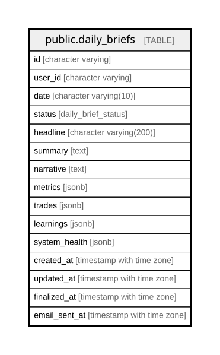

# public.daily_briefs

## Columns

| Name | Type | Default | Nullable | Children | Parents | Comment |
| ---- | ---- | ------- | -------- | -------- | ------- | ------- |
| id | character varying | gen_random_uuid() | false |  |  |  |
| user_id | character varying |  | false |  |  |  |
| date | character varying(10) |  | false |  |  |  |
| status | daily_brief_status | 'in_progress'::daily_brief_status | true |  |  |  |
| headline | character varying(200) |  | true |  |  |  |
| summary | text |  | true |  |  |  |
| narrative | text |  | true |  |  |  |
| metrics | jsonb |  | true |  |  |  |
| trades | jsonb |  | true |  |  |  |
| learnings | jsonb |  | true |  |  |  |
| system_health | jsonb |  | true |  |  |  |
| created_at | timestamp with time zone | now() | true |  |  |  |
| updated_at | timestamp with time zone | now() | true |  |  |  |
| finalized_at | timestamp with time zone |  | true |  |  |  |
| email_sent_at | timestamp with time zone |  | true |  |  |  |

## Viewpoints

| Name | Definition |
| ---- | ---------- |
| [public schema](viewpoint-schema-public.md) | All mapped relations in public. |

## Constraints

| Name | Type | Definition |
| ---- | ---- | ---------- |
| daily_briefs_pkey | PRIMARY KEY | PRIMARY KEY (id) |

## Indexes

| Name | Definition |
| ---- | ---------- |
| daily_briefs_pkey | CREATE UNIQUE INDEX daily_briefs_pkey ON public.daily_briefs USING btree (id) |

## Relations

---

> Generated by [tbls](https://github.com/k1LoW/tbls)
