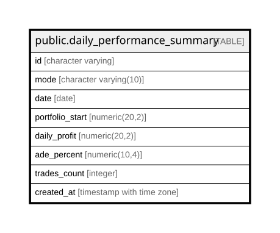

# public.daily_performance_summary

## Columns

| Name | Type | Default | Nullable | Children | Parents | Comment |
| ---- | ---- | ------- | -------- | -------- | ------- | ------- |
| id | character varying | gen_random_uuid() | false |  |  |  |
| mode | character varying(10) |  | false |  |  |  |
| date | date |  | false |  |  |  |
| portfolio_start | numeric(20,2) |  | false |  |  |  |
| daily_profit | numeric(20,2) |  | false |  |  |  |
| ade_percent | numeric(10,4) |  | false |  |  |  |
| trades_count | integer | 0 | true |  |  |  |
| created_at | timestamp with time zone | now() | true |  |  |  |

## Viewpoints

| Name | Definition |
| ---- | ---------- |
| [public schema](viewpoint-schema-public.md) | All mapped relations in public. |

## Constraints

| Name | Type | Definition |
| ---- | ---- | ---------- |
| daily_performance_summary_mode_check | CHECK | CHECK (mode::text = ANY (ARRAY['live'::character varying::text, 'paper'::character varying::text])) |
| daily_performance_summary_mode_date_unique | UNIQUE | UNIQUE (mode, date) |
| daily_performance_summary_pkey | PRIMARY KEY | PRIMARY KEY (id) |

## Indexes

| Name | Definition |
| ---- | ---------- |
| daily_performance_summary_date_idx | CREATE INDEX daily_performance_summary_date_idx ON public.daily_performance_summary USING btree (date) |
| daily_performance_summary_mode_date_unique | CREATE UNIQUE INDEX daily_performance_summary_mode_date_unique ON public.daily_performance_summary USING btree (mode, date) |
| daily_performance_summary_mode_idx | CREATE INDEX daily_performance_summary_mode_idx ON public.daily_performance_summary USING btree (mode) |
| daily_performance_summary_pkey | CREATE UNIQUE INDEX daily_performance_summary_pkey ON public.daily_performance_summary USING btree (id) |

## Relations

---

> Generated by [tbls](https://github.com/k1LoW/tbls)
