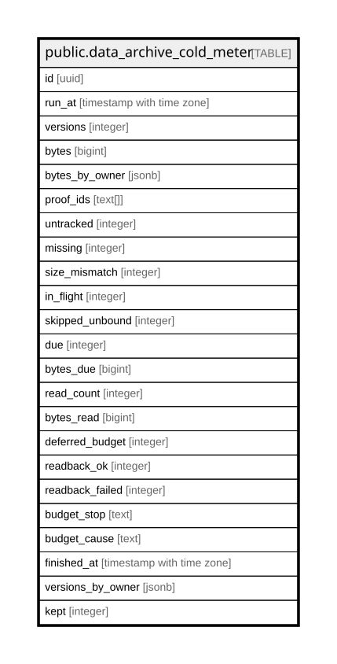

# public.data_archive_cold_meter

## Columns

| Name | Type | Default | Nullable | Children | Parents | Comment |
| ---- | ---- | ------- | -------- | -------- | ------- | ------- |
| id | uuid | gen_random_uuid() | false |  |  |  |
| run_at | timestamp with time zone |  | false |  |  |  |
| versions | integer |  | false |  |  |  |
| bytes | bigint |  | false |  |  |  |
| bytes_by_owner | jsonb |  | false |  |  |  |
| proof_ids | text[] | '{}'::text[] | false |  |  |  |
| untracked | integer | 0 | false |  |  |  |
| missing | integer | 0 | false |  |  |  |
| size_mismatch | integer | 0 | false |  |  |  |
| in_flight | integer | 0 | false |  |  |  |
| skipped_unbound | integer | 0 | false |  |  |  |
| due | integer |  | true |  |  |  |
| bytes_due | bigint |  | true |  |  |  |
| read_count | integer |  | true |  |  |  |
| bytes_read | bigint |  | true |  |  |  |
| deferred_budget | integer |  | true |  |  |  |
| readback_ok | integer |  | true |  |  |  |
| readback_failed | integer |  | true |  |  |  |
| budget_stop | text |  | true |  |  |  |
| budget_cause | text |  | true |  |  |  |
| finished_at | timestamp with time zone |  | true |  |  |  |
| versions_by_owner | jsonb |  | true |  |  |  |
| kept | integer | 0 | false |  |  |  |

## Viewpoints

| Name | Definition |
| ---- | ---------- |
| [public schema](viewpoint-schema-public.md) | All mapped relations in public. |

## Constraints

| Name | Type | Definition |
| ---- | ---- | ---------- |
| data_archive_cold_meter_budget_stop_check | CHECK | CHECK (budget_stop IS NULL OR (budget_stop = ANY (ARRAY['none'::text, 'own'::text, 'cap'::text, 'time'::text, 'disk'::text]))) |
| data_archive_cold_meter_bytes_check | CHECK | CHECK (bytes >= 0) |
| data_archive_cold_meter_owner_object_chk | CHECK | CHECK (jsonb_typeof(bytes_by_owner) = 'object'::text) |
| data_archive_cold_meter_pkey | PRIMARY KEY | PRIMARY KEY (id) |
| data_archive_cold_meter_versions_check | CHECK | CHECK (versions >= 0) |

## Indexes

| Name | Definition |
| ---- | ---------- |
| data_archive_cold_meter_pkey | CREATE UNIQUE INDEX data_archive_cold_meter_pkey ON public.data_archive_cold_meter USING btree (id) |
| data_archive_cold_meter_run_idx | CREATE INDEX data_archive_cold_meter_run_idx ON public.data_archive_cold_meter USING btree (run_at DESC) |

## Relations

---

> Generated by [tbls](https://github.com/k1LoW/tbls)
