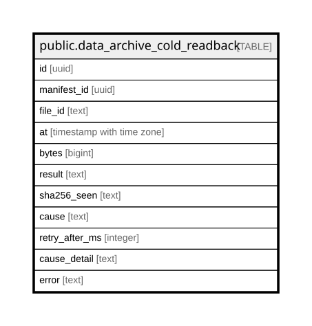

# public.data_archive_cold_readback

## Columns

| Name | Type | Default | Nullable | Children | Parents | Comment |
| ---- | ---- | ------- | -------- | -------- | ------- | ------- |
| id | uuid | gen_random_uuid() | false |  |  |  |
| manifest_id | uuid |  | false |  |  |  |
| file_id | text |  | false |  |  |  |
| at | timestamp with time zone |  | false |  |  |  |
| bytes | bigint |  | true |  |  |  |
| result | text |  | false |  |  |  |
| sha256_seen | text |  | true |  |  |  |
| cause | text |  | true |  |  |  |
| retry_after_ms | integer |  | true |  |  |  |
| cause_detail | text |  | true |  |  |  |
| error | text |  | true |  |  |  |

## Viewpoints

| Name | Definition |
| ---- | ---------- |
| [public schema](viewpoint-schema-public.md) | All mapped relations in public. |

## Constraints

| Name | Type | Definition |
| ---- | ---- | ---------- |
| data_archive_cold_readback_cause_check | CHECK | CHECK (cause IS NULL OR (cause = ANY (ARRAY['download_cap_exceeded'::text, 'transaction_cap_exceeded'::text, 'throttled_429_unidentified'::text]))) |
| data_archive_cold_readback_cause_detail_check | CHECK | CHECK (cause_detail IS NULL OR octet_length(cause_detail) <= 2048) |
| data_archive_cold_readback_pkey | PRIMARY KEY | PRIMARY KEY (id) |
| data_archive_cold_readback_result_check | CHECK | CHECK (result = ANY (ARRAY['ok'::text, 'mismatch'::text, 'budget_exhausted'::text, 'error'::text])) |

## Indexes

| Name | Definition |
| ---- | ---------- |
| data_archive_cold_readback_manifest_idx | CREATE INDEX data_archive_cold_readback_manifest_idx ON public.data_archive_cold_readback USING btree (manifest_id, at DESC) |
| data_archive_cold_readback_pkey | CREATE UNIQUE INDEX data_archive_cold_readback_pkey ON public.data_archive_cold_readback USING btree (id) |

## Relations

---

> Generated by [tbls](https://github.com/k1LoW/tbls)
