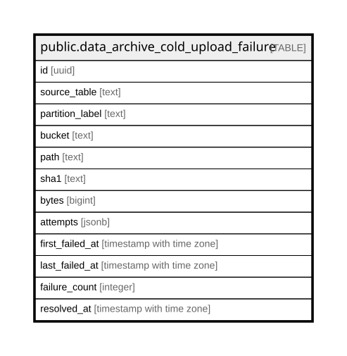

# public.data_archive_cold_upload_failure

## Columns

| Name | Type | Default | Nullable | Children | Parents | Comment |
| ---- | ---- | ------- | -------- | -------- | ------- | ------- |
| id | uuid | gen_random_uuid() | false |  |  |  |
| source_table | text |  | false |  |  |  |
| partition_label | text |  | false |  |  |  |
| bucket | text |  | false |  |  |  |
| path | text |  | false |  |  |  |
| sha1 | text |  | true |  |  |  |
| bytes | bigint |  | false |  |  |  |
| attempts | jsonb |  | false |  |  |  |
| first_failed_at | timestamp with time zone |  | false |  |  |  |
| last_failed_at | timestamp with time zone |  | false |  |  |  |
| failure_count | integer |  | false |  |  |  |
| resolved_at | timestamp with time zone |  | true |  |  |  |

## Viewpoints

| Name | Definition |
| ---- | ---------- |
| [public schema](viewpoint-schema-public.md) | All mapped relations in public. |

## Constraints

| Name | Type | Definition |
| ---- | ---- | ---------- |
| data_archive_cold_upload_failure_attempts_array_chk | CHECK | CHECK (jsonb_typeof(attempts) = 'array'::text) |
| data_archive_cold_upload_failure_failure_count_check | CHECK | CHECK (failure_count > 0) |
| data_archive_cold_upload_failure_partition_uq | UNIQUE | UNIQUE (source_table, partition_label) |
| data_archive_cold_upload_failure_pkey | PRIMARY KEY | PRIMARY KEY (id) |

## Indexes

| Name | Definition |
| ---- | ---------- |
| data_archive_cold_upload_failure_open_idx | CREATE INDEX data_archive_cold_upload_failure_open_idx ON public.data_archive_cold_upload_failure USING btree (last_failed_at) WHERE (resolved_at IS NULL) |
| data_archive_cold_upload_failure_partition_uq | CREATE UNIQUE INDEX data_archive_cold_upload_failure_partition_uq ON public.data_archive_cold_upload_failure USING btree (source_table, partition_label) |
| data_archive_cold_upload_failure_pkey | CREATE UNIQUE INDEX data_archive_cold_upload_failure_pkey ON public.data_archive_cold_upload_failure USING btree (id) |

## Relations

---

> Generated by [tbls](https://github.com/k1LoW/tbls)
