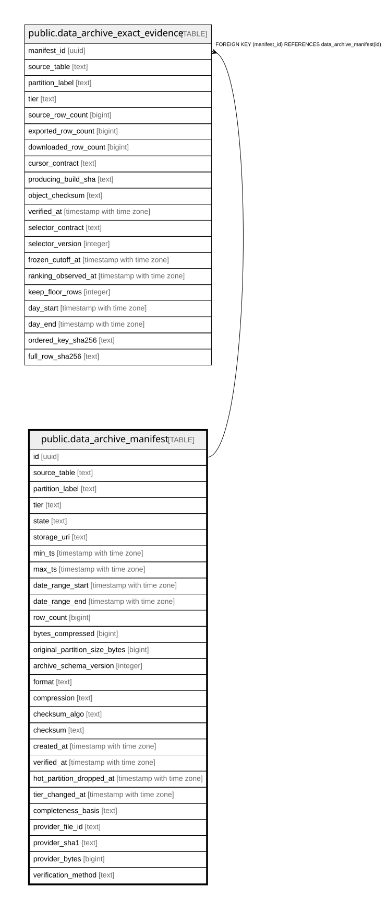

# public.data_archive_manifest

## Description

B75: single source of truth for archived partitions across warm + cold tiers. Future analytics rehydration schedulers query this table to locate data without knowing storage layout.

## Columns

| Name | Type | Default | Nullable | Children | Parents | Comment |
| ---- | ---- | ------- | -------- | -------- | ------- | ------- |
| id | uuid | gen_random_uuid() | false | [public.data_archive_exact_evidence](public.data_archive_exact_evidence.md) |  |  |
| source_table | text |  | false |  |  |  |
| partition_label | text |  | false |  |  |  |
| tier | text |  | false |  |  | warm = Supabase Storage. cold = Backblaze B2 (or S3 Glacier). Same source_partition can have BOTH rows during warm-\>cold rotation. |
| state | text | 'pending'::text | false |  |  | State machine: pending -\> uploaded -\> verified -\> active (hot dropped) -\> migrating -\> migrated. Crash recovery resumes from last good state. |
| storage_uri | text |  | false |  |  |  |
| min_ts | timestamp with time zone |  | false |  |  |  |
| max_ts | timestamp with time zone |  | false |  |  |  |
| date_range_start | timestamp with time zone |  | false |  |  |  |
| date_range_end | timestamp with time zone |  | false |  |  |  |
| row_count | bigint |  | false |  |  |  |
| bytes_compressed | bigint |  | false |  |  |  |
| original_partition_size_bytes | bigint |  | true |  |  |  |
| archive_schema_version | integer | 1 | false |  |  |  |
| format | text | 'jsonl.gz'::text | false |  |  |  |
| compression | text | 'gzip'::text | false |  |  |  |
| checksum_algo | text | 'sha256'::text | false |  |  |  |
| checksum | text |  | false |  |  |  |
| created_at | timestamp with time zone | now() | false |  |  |  |
| verified_at | timestamp with time zone |  | true |  |  |  |
| hot_partition_dropped_at | timestamp with time zone |  | true |  |  |  |
| tier_changed_at | timestamp with time zone |  | true |  |  |  |
| completeness_basis | text | 'unrecorded'::text | false |  |  | B-B75-EXPORT-COMPLETENESS (#1195). Only source-count-matched is proven: an evidence row in data_archive_exact_evidence stores source = exported = downloaded. It proves the copy matches the table as it stood at export time, not that the table held everything it should have. unverified-legacy = exported 2026-05-06..2026-10-16 with no source count, rows may be missing inside each day (Kyle 2026-10-17: no recovery). gate-deployed-unrecorded = exported under the in-snapshot count gate before this batch stored the count. unrecorded = a writer that did not stamp. |
| provider_file_id | text |  | true |  |  |  |
| provider_sha1 | text |  | true |  |  |  |
| provider_bytes | bigint |  | true |  |  |  |
| verification_method | text |  | true |  |  |  |

## Viewpoints

| Name | Definition |
| ---- | ---------- |
| [public schema](viewpoint-schema-public.md) | All mapped relations in public. |

## Constraints

| Name | Type | Definition |
| ---- | ---- | ---------- |
| data_archive_manifest_completeness_basis_chk | CHECK | CHECK (completeness_basis = ANY (ARRAY['source-count-matched'::text, 'gate-deployed-unrecorded'::text, 'unverified-legacy'::text, 'unrecorded'::text])) |
| data_archive_manifest_format_chk | CHECK | CHECK (format = ANY (ARRAY['jsonl.gz'::text, 'parquet'::text, 'file.gz'::text])) |
| data_archive_manifest_pkey | PRIMARY KEY | PRIMARY KEY (id) |
| data_archive_manifest_source_table_partition_label_tier_key | UNIQUE | UNIQUE (source_table, partition_label, tier) |
| data_archive_manifest_state_chk | CHECK | CHECK (state = ANY (ARRAY['pending'::text, 'uploaded'::text, 'verified'::text, 'active'::text, 'migrating'::text, 'migrated'::text])) |
| data_archive_manifest_tier_chk | CHECK | CHECK (tier = ANY (ARRAY['warm'::text, 'cold'::text])) |
| data_archive_manifest_verification_method_chk | CHECK | CHECK (verification_method IS NULL OR (verification_method = ANY (ARRAY['b2-sha1-attested'::text, 'sha256-roundtrip'::text]))) |

## Indexes

| Name | Definition |
| ---- | ---------- |
| data_archive_manifest_pending | CREATE INDEX data_archive_manifest_pending ON public.data_archive_manifest USING btree (source_table, partition_label) WHERE (state = ANY (ARRAY['pending'::text, 'uploaded'::text, 'verified'::text])) |
| data_archive_manifest_pkey | CREATE UNIQUE INDEX data_archive_manifest_pkey ON public.data_archive_manifest USING btree (id) |
| data_archive_manifest_source_range | CREATE INDEX data_archive_manifest_source_range ON public.data_archive_manifest USING btree (source_table, min_ts, max_ts) |
| data_archive_manifest_source_table_partition_label_tier_key | CREATE UNIQUE INDEX data_archive_manifest_source_table_partition_label_tier_key ON public.data_archive_manifest USING btree (source_table, partition_label, tier) |
| data_archive_manifest_state | CREATE INDEX data_archive_manifest_state ON public.data_archive_manifest USING btree (state) WHERE (state <> 'active'::text) |

## Relations

---

> Generated by [tbls](https://github.com/k1LoW/tbls)
