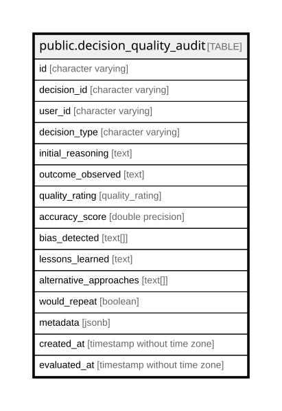

# public.decision_quality_audit

## Columns

| Name | Type | Default | Nullable | Children | Parents | Comment |
| ---- | ---- | ------- | -------- | -------- | ------- | ------- |
| id | character varying | (gen_random_uuid())::text | false |  |  |  |
| decision_id | character varying |  | false |  |  |  |
| user_id | character varying |  | true |  |  |  |
| decision_type | character varying |  | false |  |  |  |
| initial_reasoning | text |  | true |  |  |  |
| outcome_observed | text |  | true |  |  |  |
| quality_rating | quality_rating |  | false |  |  |  |
| accuracy_score | double precision |  | true |  |  |  |
| bias_detected | text[] |  | true |  |  |  |
| lessons_learned | text |  | true |  |  |  |
| alternative_approaches | text[] |  | true |  |  |  |
| would_repeat | boolean | true | true |  |  |  |
| metadata | jsonb |  | true |  |  |  |
| created_at | timestamp without time zone | now() | true |  |  |  |
| evaluated_at | timestamp without time zone | now() | true |  |  |  |

## Viewpoints

| Name | Definition |
| ---- | ---------- |
| [public schema](viewpoint-schema-public.md) | All mapped relations in public. |

## Constraints

| Name | Type | Definition |
| ---- | ---- | ---------- |
| decision_quality_audit_pkey | PRIMARY KEY | PRIMARY KEY (id) |

## Indexes

| Name | Definition |
| ---- | ---------- |
| decision_quality_audit_pkey | CREATE UNIQUE INDEX decision_quality_audit_pkey ON public.decision_quality_audit USING btree (id) |
| idx_decision_audit_created_at | CREATE INDEX idx_decision_audit_created_at ON public.decision_quality_audit USING btree (created_at) |
| idx_decision_audit_decision_id | CREATE INDEX idx_decision_audit_decision_id ON public.decision_quality_audit USING btree (decision_id) |
| idx_decision_audit_quality | CREATE INDEX idx_decision_audit_quality ON public.decision_quality_audit USING btree (quality_rating) |
| idx_decision_audit_user_id | CREATE INDEX idx_decision_audit_user_id ON public.decision_quality_audit USING btree (user_id) |

## Relations

---

> Generated by [tbls](https://github.com/k1LoW/tbls)
