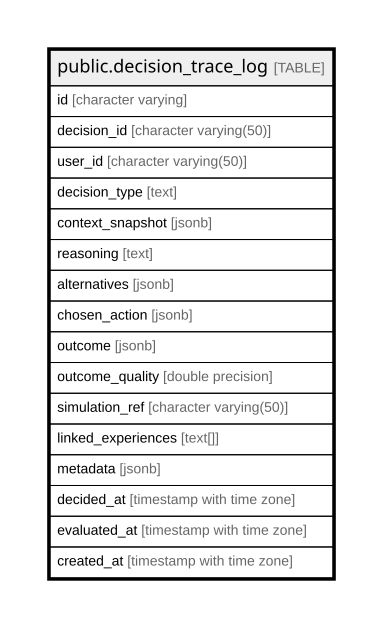

# public.decision_trace_log

## Columns

| Name | Type | Default | Nullable | Children | Parents | Comment |
| ---- | ---- | ------- | -------- | -------- | ------- | ------- |
| id | character varying | gen_random_uuid() | false |  |  |  |
| decision_id | character varying(50) |  | false |  |  |  |
| user_id | character varying(50) |  | true |  |  |  |
| decision_type | text |  | false |  |  |  |
| context_snapshot | jsonb |  | false |  |  |  |
| reasoning | text |  | false |  |  |  |
| alternatives | jsonb | '[]'::jsonb | false |  |  |  |
| chosen_action | jsonb |  | false |  |  |  |
| outcome | jsonb |  | true |  |  |  |
| outcome_quality | double precision |  | true |  |  |  |
| simulation_ref | character varying(50) |  | true |  |  |  |
| linked_experiences | text[] | ARRAY[]::text[] | true |  |  |  |
| metadata | jsonb |  | true |  |  |  |
| decided_at | timestamp with time zone | now() | false |  |  |  |
| evaluated_at | timestamp with time zone |  | true |  |  |  |
| created_at | timestamp with time zone | now() | false |  |  |  |

## Viewpoints

| Name | Definition |
| ---- | ---------- |
| [public schema](viewpoint-schema-public.md) | All mapped relations in public. |

## Constraints

| Name | Type | Definition |
| ---- | ---- | ---------- |
| decision_trace_log_decision_id_key | UNIQUE | UNIQUE (decision_id) |
| decision_trace_log_pkey | PRIMARY KEY | PRIMARY KEY (id) |

## Indexes

| Name | Definition |
| ---- | ---------- |
| decision_trace_log_decision_id_idx | CREATE INDEX decision_trace_log_decision_id_idx ON public.decision_trace_log USING btree (decision_id) |
| decision_trace_log_decision_id_key | CREATE UNIQUE INDEX decision_trace_log_decision_id_key ON public.decision_trace_log USING btree (decision_id) |
| decision_trace_log_decision_type_idx | CREATE INDEX decision_trace_log_decision_type_idx ON public.decision_trace_log USING btree (decision_type) |
| decision_trace_log_pkey | CREATE UNIQUE INDEX decision_trace_log_pkey ON public.decision_trace_log USING btree (id) |
| decision_trace_log_simulation_ref_idx | CREATE INDEX decision_trace_log_simulation_ref_idx ON public.decision_trace_log USING btree (simulation_ref) |
| decision_trace_log_user_id_idx | CREATE INDEX decision_trace_log_user_id_idx ON public.decision_trace_log USING btree (user_id) |

## Relations

---

> Generated by [tbls](https://github.com/k1LoW/tbls)
