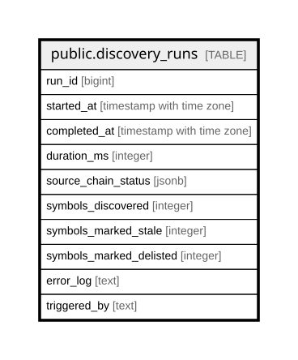

# public.discovery_runs

## Columns

| Name | Type | Default | Nullable | Children | Parents | Comment |
| ---- | ---- | ------- | -------- | -------- | ------- | ------- |
| run_id | bigint | nextval('discovery_runs_run_id_seq'::regclass) | false |  |  |  |
| started_at | timestamp with time zone | now() | false |  |  |  |
| completed_at | timestamp with time zone |  | true |  |  |  |
| duration_ms | integer |  | true |  |  |  |
| source_chain_status | jsonb |  | false |  |  |  |
| symbols_discovered | integer | 0 | false |  |  |  |
| symbols_marked_stale | integer | 0 | false |  |  |  |
| symbols_marked_delisted | integer | 0 | false |  |  |  |
| error_log | text |  | true |  |  |  |
| triggered_by | text |  | false |  |  |  |

## Viewpoints

| Name | Definition |
| ---- | ---------- |
| [public schema](viewpoint-schema-public.md) | All mapped relations in public. |

## Constraints

| Name | Type | Definition |
| ---- | ---- | ---------- |
| discovery_runs_pkey | PRIMARY KEY | PRIMARY KEY (run_id) |
| discovery_runs_triggered_by_check | CHECK | CHECK (triggered_by = ANY (ARRAY['cron_daily'::text, 'manual_endpoint'::text, 'boot_smoke'::text])) |

## Indexes

| Name | Definition |
| ---- | ---------- |
| discovery_runs_pkey | CREATE UNIQUE INDEX discovery_runs_pkey ON public.discovery_runs USING btree (run_id) |
| idx_discovery_runs_started_at | CREATE INDEX idx_discovery_runs_started_at ON public.discovery_runs USING btree (started_at) |

## Relations

---

> Generated by [tbls](https://github.com/k1LoW/tbls)
