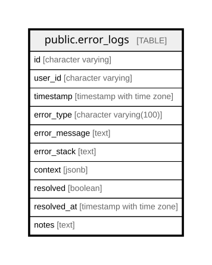

# public.error_logs

## Columns

| Name | Type | Default | Nullable | Children | Parents | Comment |
| ---- | ---- | ------- | -------- | -------- | ------- | ------- |
| id | character varying | gen_random_uuid() | false |  |  |  |
| user_id | character varying |  | true |  |  |  |
| timestamp | timestamp with time zone | now() | true |  |  |  |
| error_type | character varying(100) |  | false |  |  |  |
| error_message | text |  | false |  |  |  |
| error_stack | text |  | true |  |  |  |
| context | jsonb |  | true |  |  |  |
| resolved | boolean | false | true |  |  |  |
| resolved_at | timestamp with time zone |  | true |  |  |  |
| notes | text |  | true |  |  |  |

## Viewpoints

| Name | Definition |
| ---- | ---------- |
| [public schema](viewpoint-schema-public.md) | All mapped relations in public. |

## Constraints

| Name | Type | Definition |
| ---- | ---- | ---------- |
| error_logs_pkey | PRIMARY KEY | PRIMARY KEY (id) |

## Indexes

| Name | Definition |
| ---- | ---------- |
| error_logs_pkey | CREATE UNIQUE INDEX error_logs_pkey ON public.error_logs USING btree (id) |

## Relations

---

> Generated by [tbls](https://github.com/k1LoW/tbls)
