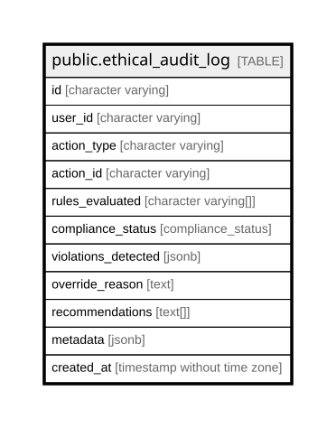

# public.ethical_audit_log

## Columns

| Name | Type | Default | Nullable | Children | Parents | Comment |
| ---- | ---- | ------- | -------- | -------- | ------- | ------- |
| id | character varying | (gen_random_uuid())::text | false |  |  |  |
| user_id | character varying |  | true |  |  |  |
| action_type | character varying |  | false |  |  |  |
| action_id | character varying |  | true |  |  |  |
| rules_evaluated | character varying[] |  | false |  |  |  |
| compliance_status | compliance_status |  | false |  |  |  |
| violations_detected | jsonb |  | true |  |  |  |
| override_reason | text |  | true |  |  |  |
| recommendations | text[] |  | true |  |  |  |
| metadata | jsonb |  | true |  |  |  |
| created_at | timestamp without time zone | now() | true |  |  |  |

## Viewpoints

| Name | Definition |
| ---- | ---------- |
| [public schema](viewpoint-schema-public.md) | All mapped relations in public. |

## Constraints

| Name | Type | Definition |
| ---- | ---- | ---------- |
| ethical_audit_log_pkey | PRIMARY KEY | PRIMARY KEY (id) |

## Indexes

| Name | Definition |
| ---- | ---------- |
| ethical_audit_log_pkey | CREATE UNIQUE INDEX ethical_audit_log_pkey ON public.ethical_audit_log USING btree (id) |
| idx_ethical_audit_log_compliance | CREATE INDEX idx_ethical_audit_log_compliance ON public.ethical_audit_log USING btree (compliance_status) |
| idx_ethical_audit_log_user_created | CREATE INDEX idx_ethical_audit_log_user_created ON public.ethical_audit_log USING btree (user_id, created_at DESC) |

## Relations

---

> Generated by [tbls](https://github.com/k1LoW/tbls)
