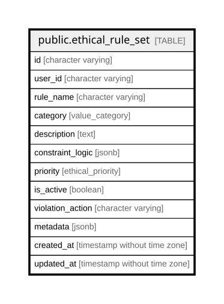

# public.ethical_rule_set

## Columns

| Name | Type | Default | Nullable | Children | Parents | Comment |
| ---- | ---- | ------- | -------- | -------- | ------- | ------- |
| id | character varying | (gen_random_uuid())::text | false |  |  |  |
| user_id | character varying |  | true |  |  |  |
| rule_name | character varying |  | false |  |  |  |
| category | value_category |  | false |  |  |  |
| description | text |  | true |  |  |  |
| constraint_logic | jsonb |  | false |  |  |  |
| priority | ethical_priority | 'medium'::ethical_priority | false |  |  |  |
| is_active | boolean | true | true |  |  |  |
| violation_action | character varying | 'block'::character varying | true |  |  |  |
| metadata | jsonb |  | true |  |  |  |
| created_at | timestamp without time zone | now() | true |  |  |  |
| updated_at | timestamp without time zone | now() | true |  |  |  |

## Viewpoints

| Name | Definition |
| ---- | ---------- |
| [public schema](viewpoint-schema-public.md) | All mapped relations in public. |

## Constraints

| Name | Type | Definition |
| ---- | ---- | ---------- |
| ethical_rule_set_pkey | PRIMARY KEY | PRIMARY KEY (id) |

## Indexes

| Name | Definition |
| ---- | ---------- |
| ethical_rule_set_pkey | CREATE UNIQUE INDEX ethical_rule_set_pkey ON public.ethical_rule_set USING btree (id) |
| idx_ethical_rule_set_user_active | CREATE INDEX idx_ethical_rule_set_user_active ON public.ethical_rule_set USING btree (user_id, is_active) |

## Relations

---

> Generated by [tbls](https://github.com/k1LoW/tbls)
