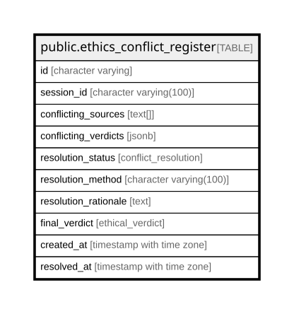

# public.ethics_conflict_register

## Columns

| Name | Type | Default | Nullable | Children | Parents | Comment |
| ---- | ---- | ------- | -------- | -------- | ------- | ------- |
| id | character varying | gen_random_uuid() | false |  |  |  |
| session_id | character varying(100) |  | false |  |  |  |
| conflicting_sources | text[] |  | false |  |  |  |
| conflicting_verdicts | jsonb |  | false |  |  |  |
| resolution_status | conflict_resolution | 'open'::conflict_resolution | false |  |  |  |
| resolution_method | character varying(100) |  | true |  |  |  |
| resolution_rationale | text |  | true |  |  |  |
| final_verdict | ethical_verdict |  | true |  |  |  |
| created_at | timestamp with time zone | now() | false |  |  |  |
| resolved_at | timestamp with time zone |  | true |  |  |  |

## Viewpoints

| Name | Definition |
| ---- | ---------- |
| [public schema](viewpoint-schema-public.md) | All mapped relations in public. |

## Constraints

| Name | Type | Definition |
| ---- | ---- | ---------- |
| ethics_conflict_register_pkey | PRIMARY KEY | PRIMARY KEY (id) |

## Indexes

| Name | Definition |
| ---- | ---------- |
| ethics_conflict_register_created_at_idx | CREATE INDEX ethics_conflict_register_created_at_idx ON public.ethics_conflict_register USING btree (created_at) |
| ethics_conflict_register_pkey | CREATE UNIQUE INDEX ethics_conflict_register_pkey ON public.ethics_conflict_register USING btree (id) |
| ethics_conflict_register_session_id_idx | CREATE INDEX ethics_conflict_register_session_id_idx ON public.ethics_conflict_register USING btree (session_id) |
| ethics_conflict_register_status_idx | CREATE INDEX ethics_conflict_register_status_idx ON public.ethics_conflict_register USING btree (resolution_status) |

## Relations

---

> Generated by [tbls](https://github.com/k1LoW/tbls)
