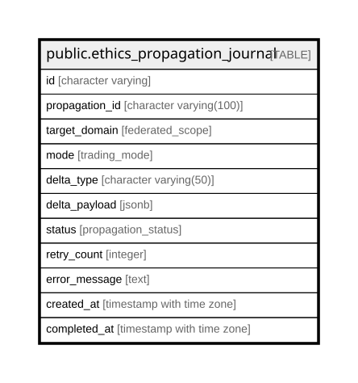

# public.ethics_propagation_journal

## Columns

| Name | Type | Default | Nullable | Children | Parents | Comment |
| ---- | ---- | ------- | -------- | -------- | ------- | ------- |
| id | character varying | gen_random_uuid() | false |  |  |  |
| propagation_id | character varying(100) |  | false |  |  |  |
| target_domain | federated_scope |  | false |  |  |  |
| mode | trading_mode |  | false |  |  |  |
| delta_type | character varying(50) |  | false |  |  |  |
| delta_payload | jsonb |  | false |  |  |  |
| status | propagation_status | 'pending'::propagation_status | false |  |  |  |
| retry_count | integer | 0 | false |  |  |  |
| error_message | text |  | true |  |  |  |
| created_at | timestamp with time zone | now() | false |  |  |  |
| completed_at | timestamp with time zone |  | true |  |  |  |

## Viewpoints

| Name | Definition |
| ---- | ---------- |
| [public schema](viewpoint-schema-public.md) | All mapped relations in public. |

## Constraints

| Name | Type | Definition |
| ---- | ---- | ---------- |
| ethics_propagation_journal_pkey | PRIMARY KEY | PRIMARY KEY (id) |

## Indexes

| Name | Definition |
| ---- | ---------- |
| ethics_propagation_journal_created_at_idx | CREATE INDEX ethics_propagation_journal_created_at_idx ON public.ethics_propagation_journal USING btree (created_at) |
| ethics_propagation_journal_pkey | CREATE UNIQUE INDEX ethics_propagation_journal_pkey ON public.ethics_propagation_journal USING btree (id) |
| ethics_propagation_journal_propagation_id_idx | CREATE INDEX ethics_propagation_journal_propagation_id_idx ON public.ethics_propagation_journal USING btree (propagation_id) |
| ethics_propagation_journal_status_idx | CREATE INDEX ethics_propagation_journal_status_idx ON public.ethics_propagation_journal USING btree (status) |
| ethics_propagation_journal_target_domain_idx | CREATE INDEX ethics_propagation_journal_target_domain_idx ON public.ethics_propagation_journal USING btree (target_domain) |

## Relations

---

> Generated by [tbls](https://github.com/k1LoW/tbls)
