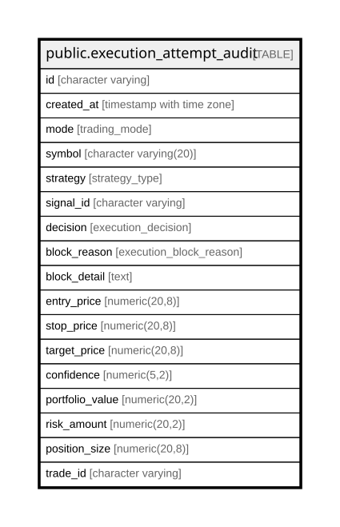

# public.execution_attempt_audit

## Columns

| Name | Type | Default | Nullable | Children | Parents | Comment |
| ---- | ---- | ------- | -------- | -------- | ------- | ------- |
| id | character varying | gen_random_uuid() | false |  |  |  |
| created_at | timestamp with time zone | now() | false |  |  |  |
| mode | trading_mode |  | false |  |  |  |
| symbol | character varying(20) |  | false |  |  |  |
| strategy | strategy_type |  | false |  |  |  |
| signal_id | character varying |  | true |  |  |  |
| decision | execution_decision |  | false |  |  |  |
| block_reason | execution_block_reason |  | true |  |  |  |
| block_detail | text |  | true |  |  |  |
| entry_price | numeric(20,8) |  | true |  |  |  |
| stop_price | numeric(20,8) |  | true |  |  |  |
| target_price | numeric(20,8) |  | true |  |  |  |
| confidence | numeric(5,2) |  | true |  |  |  |
| portfolio_value | numeric(20,2) |  | true |  |  |  |
| risk_amount | numeric(20,2) |  | true |  |  |  |
| position_size | numeric(20,8) |  | true |  |  |  |
| trade_id | character varying |  | true |  |  |  |

## Viewpoints

| Name | Definition |
| ---- | ---------- |
| [public schema](viewpoint-schema-public.md) | All mapped relations in public. |

## Constraints

| Name | Type | Definition |
| ---- | ---- | ---------- |
| execution_attempt_audit_pkey | PRIMARY KEY | PRIMARY KEY (id) |

## Indexes

| Name | Definition |
| ---- | ---------- |
| execution_attempt_audit_created_at_idx | CREATE INDEX execution_attempt_audit_created_at_idx ON public.execution_attempt_audit USING btree (created_at) |
| execution_attempt_audit_decision_idx | CREATE INDEX execution_attempt_audit_decision_idx ON public.execution_attempt_audit USING btree (decision) |
| execution_attempt_audit_mode_idx | CREATE INDEX execution_attempt_audit_mode_idx ON public.execution_attempt_audit USING btree (mode) |
| execution_attempt_audit_pkey | CREATE UNIQUE INDEX execution_attempt_audit_pkey ON public.execution_attempt_audit USING btree (id) |
| execution_attempt_audit_strategy_idx | CREATE INDEX execution_attempt_audit_strategy_idx ON public.execution_attempt_audit USING btree (strategy) |
| execution_attempt_audit_symbol_idx | CREATE INDEX execution_attempt_audit_symbol_idx ON public.execution_attempt_audit USING btree (symbol) |
| idx_exec_audit_created | CREATE INDEX idx_exec_audit_created ON public.execution_attempt_audit USING btree (created_at DESC) |
| idx_exec_audit_decision | CREATE INDEX idx_exec_audit_decision ON public.execution_attempt_audit USING btree (decision) |
| idx_exec_audit_mode | CREATE INDEX idx_exec_audit_mode ON public.execution_attempt_audit USING btree (mode) |
| idx_exec_audit_strategy | CREATE INDEX idx_exec_audit_strategy ON public.execution_attempt_audit USING btree (strategy) |
| idx_exec_audit_symbol | CREATE INDEX idx_exec_audit_symbol ON public.execution_attempt_audit USING btree (symbol) |

## Relations

---

> Generated by [tbls](https://github.com/k1LoW/tbls)
