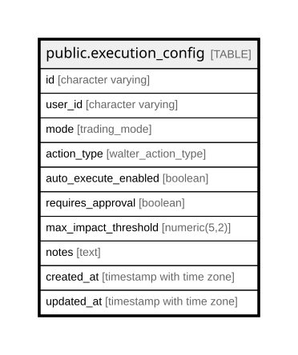

# public.execution_config

## Columns

| Name | Type | Default | Nullable | Children | Parents | Comment |
| ---- | ---- | ------- | -------- | -------- | ------- | ------- |
| id | character varying | gen_random_uuid() | false |  |  |  |
| user_id | character varying |  | false |  |  |  |
| mode | trading_mode |  | false |  |  |  |
| action_type | walter_action_type |  | false |  |  |  |
| auto_execute_enabled | boolean | false | false |  |  |  |
| requires_approval | boolean | true | false |  |  |  |
| max_impact_threshold | numeric(5,2) | 50.00 | true |  |  |  |
| notes | text |  | true |  |  |  |
| created_at | timestamp with time zone | now() | true |  |  |  |
| updated_at | timestamp with time zone | now() | true |  |  |  |

## Viewpoints

| Name | Definition |
| ---- | ---------- |
| [public schema](viewpoint-schema-public.md) | All mapped relations in public. |

## Constraints

| Name | Type | Definition |
| ---- | ---- | ---------- |
| execution_config_pkey | PRIMARY KEY | PRIMARY KEY (id) |
| execution_config_user_id_mode_action_type_key | UNIQUE | UNIQUE (user_id, mode, action_type) |

## Indexes

| Name | Definition |
| ---- | ---------- |
| execution_config_action_type_idx | CREATE INDEX execution_config_action_type_idx ON public.execution_config USING btree (action_type) |
| execution_config_pkey | CREATE UNIQUE INDEX execution_config_pkey ON public.execution_config USING btree (id) |
| execution_config_user_id_mode_action_type_key | CREATE UNIQUE INDEX execution_config_user_id_mode_action_type_key ON public.execution_config USING btree (user_id, mode, action_type) |
| execution_config_user_mode_idx | CREATE INDEX execution_config_user_mode_idx ON public.execution_config USING btree (user_id, mode) |

## Relations

---

> Generated by [tbls](https://github.com/k1LoW/tbls)
