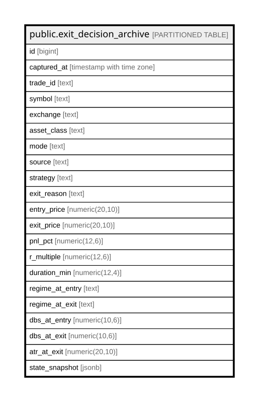

# public.exit_decision_archive

## Columns

| Name | Type | Default | Nullable | Children | Parents | Comment |
| ---- | ---- | ------- | -------- | -------- | ------- | ------- |
| id | bigint | nextval('exit_decision_archive_id_seq'::regclass) | false |  |  |  |
| captured_at | timestamp with time zone | now() | false |  |  |  |
| trade_id | text |  | false |  |  |  |
| symbol | text |  | false |  |  |  |
| exchange | text |  | false |  |  |  |
| asset_class | text |  | false |  |  |  |
| mode | text |  | false |  |  |  |
| source | text |  | false |  |  |  |
| strategy | text |  | true |  |  |  |
| exit_reason | text |  | false |  |  |  |
| entry_price | numeric(20,10) |  | true |  |  |  |
| exit_price | numeric(20,10) |  | true |  |  |  |
| pnl_pct | numeric(12,6) |  | true |  |  |  |
| r_multiple | numeric(12,6) |  | true |  |  |  |
| duration_min | numeric(12,4) |  | true |  |  |  |
| regime_at_entry | text |  | true |  |  |  |
| regime_at_exit | text |  | true |  |  |  |
| dbs_at_entry | numeric(10,6) |  | true |  |  |  |
| dbs_at_exit | numeric(10,6) |  | true |  |  |  |
| atr_at_exit | numeric(20,10) |  | true |  |  |  |
| state_snapshot | jsonb | '{"schema_version": 1}'::jsonb | false |  |  |  |

## Viewpoints

| Name | Definition |
| ---- | ---------- |
| [public schema](viewpoint-schema-public.md) | All mapped relations in public. |

## Constraints

| Name | Type | Definition |
| ---- | ---- | ---------- |
| exit_decision_archive_pkey | PRIMARY KEY | PRIMARY KEY (captured_at, trade_id, id) |

## Indexes

| Name | Definition |
| ---- | ---------- |
| exit_decision_archive_mode_time | CREATE INDEX exit_decision_archive_mode_time ON ONLY public.exit_decision_archive USING btree (mode, captured_at DESC) |
| exit_decision_archive_pkey | CREATE UNIQUE INDEX exit_decision_archive_pkey ON ONLY public.exit_decision_archive USING btree (captured_at, trade_id, id) |
| exit_decision_archive_reason_time | CREATE INDEX exit_decision_archive_reason_time ON ONLY public.exit_decision_archive USING btree (exit_reason, captured_at DESC) |
| exit_decision_archive_sym_time | CREATE INDEX exit_decision_archive_sym_time ON ONLY public.exit_decision_archive USING btree (symbol, captured_at DESC) |
| exit_decision_archive_trade | CREATE INDEX exit_decision_archive_trade ON ONLY public.exit_decision_archive USING btree (trade_id) |

## Relations

---

> Generated by [tbls](https://github.com/k1LoW/tbls)
