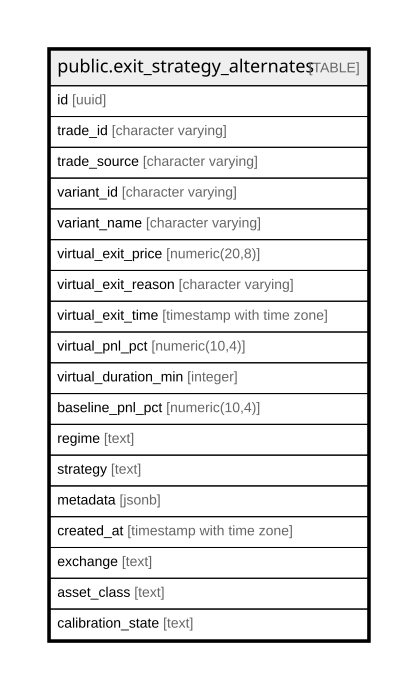

# public.exit_strategy_alternates

## Columns

| Name | Type | Default | Nullable | Children | Parents | Comment |
| ---- | ---- | ------- | -------- | -------- | ------- | ------- |
| id | uuid | gen_random_uuid() | false |  |  |  |
| trade_id | character varying |  | false |  |  |  |
| trade_source | character varying |  | false |  |  |  |
| variant_id | character varying |  | false |  |  |  |
| variant_name | character varying |  | false |  |  |  |
| virtual_exit_price | numeric(20,8) |  | true |  |  |  |
| virtual_exit_reason | character varying |  | false |  |  |  |
| virtual_exit_time | timestamp with time zone |  | true |  |  |  |
| virtual_pnl_pct | numeric(10,4) |  | true |  |  |  |
| virtual_duration_min | integer |  | true |  |  |  |
| baseline_pnl_pct | numeric(10,4) |  | true |  |  |  |
| regime | text |  | true |  |  |  |
| strategy | text |  | true |  |  |  |
| metadata | jsonb |  | true |  |  |  |
| created_at | timestamp with time zone | now() | false |  |  |  |
| exchange | text | 'kraken'::text | false |  |  |  |
| asset_class | text | 'crypto_spot'::text | false |  |  |  |
| calibration_state | text |  | true |  |  | B-XSTOCK-CALIB F-NOW (2026-06-01): mirror of the parent vts_open_trades trade's calibration_state, written by persistExits via a correlated sub-select on originalSignalId. NULL for paper-sourced rows (VTS-only) and for pre-F-NOW crypto rows. The xStocks exit-ablation aggregator excludes 'pre_calibration_xstock_2026_05' rows when scoped to xstock_spot. |

## Viewpoints

| Name | Definition |
| ---- | ---------- |
| [public schema](viewpoint-schema-public.md) | All mapped relations in public. |

## Constraints

| Name | Type | Definition |
| ---- | ---- | ---------- |
| exit_strategy_alternates_pkey | PRIMARY KEY | PRIMARY KEY (id) |
| exit_strategy_alternates_trade_source_check | CHECK | CHECK (trade_source::text = ANY (ARRAY['paper'::character varying, 'vts'::character varying]::text[])) |
| exit_strategy_alternates_unique | UNIQUE | UNIQUE (trade_id, variant_id) |

## Indexes

| Name | Definition |
| ---- | ---------- |
| exit_strategy_alternates_pkey | CREATE UNIQUE INDEX exit_strategy_alternates_pkey ON public.exit_strategy_alternates USING btree (id) |
| exit_strategy_alternates_unique | CREATE UNIQUE INDEX exit_strategy_alternates_unique ON public.exit_strategy_alternates USING btree (trade_id, variant_id) |
| idx_exit_strategy_alternates_asset_created | CREATE INDEX idx_exit_strategy_alternates_asset_created ON public.exit_strategy_alternates USING btree (asset_class, created_at DESC) |
| idx_exit_strategy_alternates_regime_variant | CREATE INDEX idx_exit_strategy_alternates_regime_variant ON public.exit_strategy_alternates USING btree (regime, variant_id) |
| idx_exit_strategy_alternates_variant_created | CREATE INDEX idx_exit_strategy_alternates_variant_created ON public.exit_strategy_alternates USING btree (variant_id, created_at) |

## Relations

---

> Generated by [tbls](https://github.com/k1LoW/tbls)
