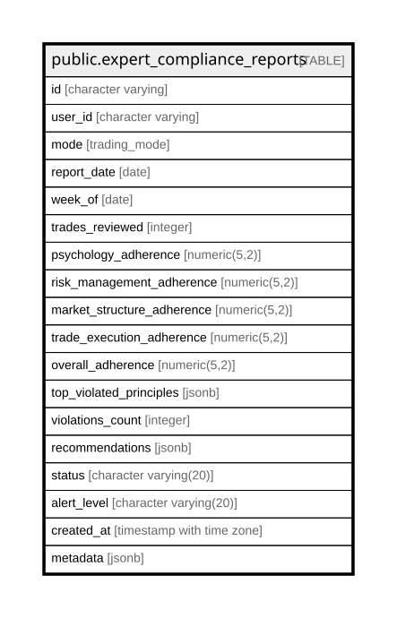

# public.expert_compliance_reports

## Columns

| Name | Type | Default | Nullable | Children | Parents | Comment |
| ---- | ---- | ------- | -------- | -------- | ------- | ------- |
| id | character varying | gen_random_uuid() | false |  |  |  |
| user_id | character varying |  | false |  |  |  |
| mode | trading_mode |  | false |  |  |  |
| report_date | date |  | false |  |  |  |
| week_of | date |  | false |  |  |  |
| trades_reviewed | integer |  | false |  |  |  |
| psychology_adherence | numeric(5,2) |  | true |  |  |  |
| risk_management_adherence | numeric(5,2) |  | true |  |  |  |
| market_structure_adherence | numeric(5,2) |  | true |  |  |  |
| trade_execution_adherence | numeric(5,2) |  | true |  |  |  |
| overall_adherence | numeric(5,2) |  | true |  |  |  |
| top_violated_principles | jsonb |  | true |  |  |  |
| violations_count | integer | 0 | true |  |  |  |
| recommendations | jsonb |  | true |  |  |  |
| status | character varying(20) | 'completed'::character varying | true |  |  |  |
| alert_level | character varying(20) |  | true |  |  |  |
| created_at | timestamp with time zone | now() | true |  |  |  |
| metadata | jsonb |  | true |  |  |  |

## Viewpoints

| Name | Definition |
| ---- | ---------- |
| [public schema](viewpoint-schema-public.md) | All mapped relations in public. |

## Constraints

| Name | Type | Definition |
| ---- | ---- | ---------- |
| expert_compliance_reports_pkey | PRIMARY KEY | PRIMARY KEY (id) |

## Indexes

| Name | Definition |
| ---- | ---------- |
| expert_compliance_reports_pkey | CREATE UNIQUE INDEX expert_compliance_reports_pkey ON public.expert_compliance_reports USING btree (id) |

## Relations

---

> Generated by [tbls](https://github.com/k1LoW/tbls)
