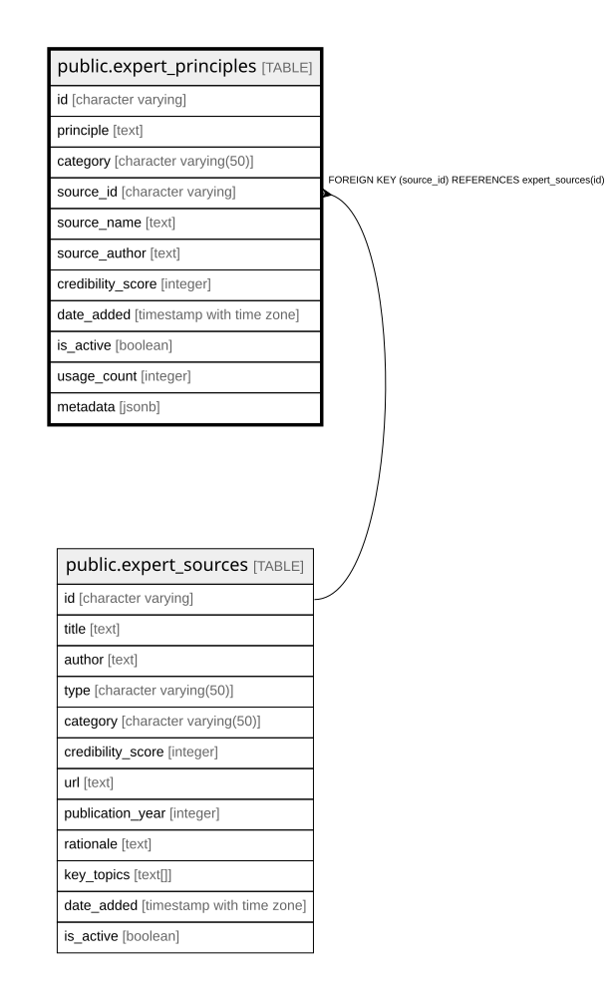

# public.expert_principles

## Columns

| Name | Type | Default | Nullable | Children | Parents | Comment |
| ---- | ---- | ------- | -------- | -------- | ------- | ------- |
| id | character varying | gen_random_uuid() | false |  |  |  |
| principle | text |  | false |  |  |  |
| category | character varying(50) |  | false |  |  |  |
| source_id | character varying |  | false |  | [public.expert_sources](public.expert_sources.md) |  |
| source_name | text |  | false |  |  |  |
| source_author | text |  | false |  |  |  |
| credibility_score | integer |  | false |  |  |  |
| date_added | timestamp with time zone | now() | true |  |  |  |
| is_active | boolean | true | true |  |  |  |
| usage_count | integer | 0 | true |  |  |  |
| metadata | jsonb |  | true |  |  |  |

## Viewpoints

| Name | Definition |
| ---- | ---------- |
| [public schema](viewpoint-schema-public.md) | All mapped relations in public. |

## Constraints

| Name | Type | Definition |
| ---- | ---- | ---------- |
| expert_principles_pkey | PRIMARY KEY | PRIMARY KEY (id) |
| expert_principles_source_id_expert_sources_id_fk | FOREIGN KEY | FOREIGN KEY (source_id) REFERENCES expert_sources(id) |

## Indexes

| Name | Definition |
| ---- | ---------- |
| expert_principles_pkey | CREATE UNIQUE INDEX expert_principles_pkey ON public.expert_principles USING btree (id) |

## Relations

---

> Generated by [tbls](https://github.com/k1LoW/tbls)
