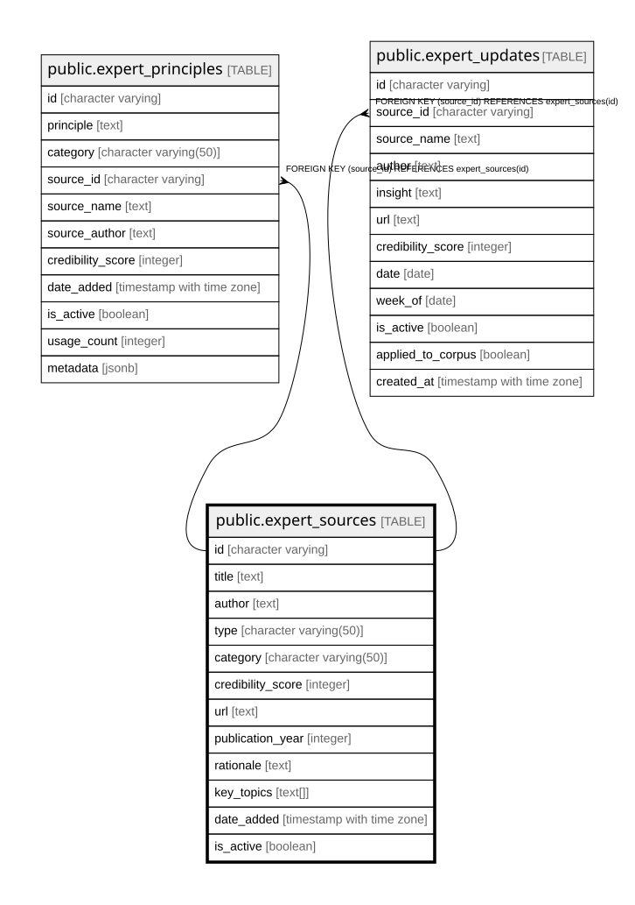

# public.expert_sources

## Columns

| Name | Type | Default | Nullable | Children | Parents | Comment |
| ---- | ---- | ------- | -------- | -------- | ------- | ------- |
| id | character varying | gen_random_uuid() | false | [public.expert_principles](public.expert_principles.md) [public.expert_updates](public.expert_updates.md) |  |  |
| title | text |  | false |  |  |  |
| author | text |  | false |  |  |  |
| type | character varying(50) |  | false |  |  |  |
| category | character varying(50) |  | false |  |  |  |
| credibility_score | integer |  | false |  |  |  |
| url | text |  | true |  |  |  |
| publication_year | integer |  | true |  |  |  |
| rationale | text |  | true |  |  |  |
| key_topics | text[] |  | true |  |  |  |
| date_added | timestamp with time zone | now() | true |  |  |  |
| is_active | boolean | true | true |  |  |  |

## Viewpoints

| Name | Definition |
| ---- | ---------- |
| [public schema](viewpoint-schema-public.md) | All mapped relations in public. |

## Constraints

| Name | Type | Definition |
| ---- | ---- | ---------- |
| expert_sources_pkey | PRIMARY KEY | PRIMARY KEY (id) |

## Indexes

| Name | Definition |
| ---- | ---------- |
| expert_sources_pkey | CREATE UNIQUE INDEX expert_sources_pkey ON public.expert_sources USING btree (id) |

## Relations

---

> Generated by [tbls](https://github.com/k1LoW/tbls)
