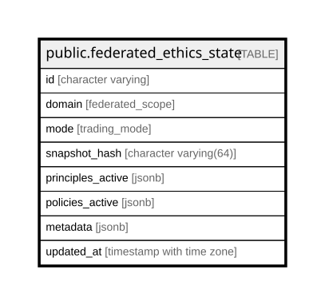

# public.federated_ethics_state

## Columns

| Name | Type | Default | Nullable | Children | Parents | Comment |
| ---- | ---- | ------- | -------- | -------- | ------- | ------- |
| id | character varying | gen_random_uuid() | false |  |  |  |
| domain | federated_scope |  | false |  |  |  |
| mode | trading_mode |  | false |  |  |  |
| snapshot_hash | character varying(64) |  | false |  |  |  |
| principles_active | jsonb |  | false |  |  |  |
| policies_active | jsonb |  | false |  |  |  |
| metadata | jsonb |  | true |  |  |  |
| updated_at | timestamp with time zone | now() | false |  |  |  |

## Viewpoints

| Name | Definition |
| ---- | ---------- |
| [public schema](viewpoint-schema-public.md) | All mapped relations in public. |

## Constraints

| Name | Type | Definition |
| ---- | ---- | ---------- |
| federated_ethics_state_pkey | PRIMARY KEY | PRIMARY KEY (id) |

## Indexes

| Name | Definition |
| ---- | ---------- |
| federated_ethics_state_domain_mode_idx | CREATE INDEX federated_ethics_state_domain_mode_idx ON public.federated_ethics_state USING btree (domain, mode) |
| federated_ethics_state_pkey | CREATE UNIQUE INDEX federated_ethics_state_pkey ON public.federated_ethics_state USING btree (id) |
| federated_ethics_state_updated_at_idx | CREATE INDEX federated_ethics_state_updated_at_idx ON public.federated_ethics_state USING btree (updated_at) |

## Relations

---

> Generated by [tbls](https://github.com/k1LoW/tbls)
