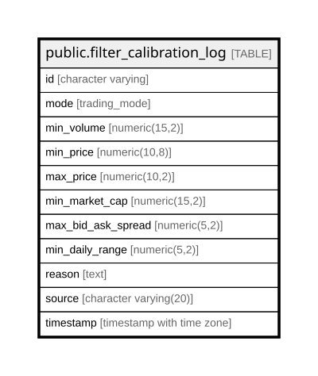

# public.filter_calibration_log

## Columns

| Name | Type | Default | Nullable | Children | Parents | Comment |
| ---- | ---- | ------- | -------- | -------- | ------- | ------- |
| id | character varying | gen_random_uuid() | false |  |  |  |
| mode | trading_mode |  | false |  |  |  |
| min_volume | numeric(15,2) |  | true |  |  |  |
| min_price | numeric(10,8) |  | true |  |  |  |
| max_price | numeric(10,2) |  | true |  |  |  |
| min_market_cap | numeric(15,2) |  | true |  |  |  |
| max_bid_ask_spread | numeric(5,2) |  | true |  |  |  |
| min_daily_range | numeric(5,2) |  | true |  |  |  |
| reason | text |  | true |  |  |  |
| source | character varying(20) | 'system'::character varying | true |  |  |  |
| timestamp | timestamp with time zone | now() | true |  |  |  |

## Viewpoints

| Name | Definition |
| ---- | ---------- |
| [public schema](viewpoint-schema-public.md) | All mapped relations in public. |

## Constraints

| Name | Type | Definition |
| ---- | ---- | ---------- |
| filter_calibration_log_pkey | PRIMARY KEY | PRIMARY KEY (id) |

## Indexes

| Name | Definition |
| ---- | ---------- |
| filter_calibration_log_pkey | CREATE UNIQUE INDEX filter_calibration_log_pkey ON public.filter_calibration_log USING btree (id) |

## Relations

---

> Generated by [tbls](https://github.com/k1LoW/tbls)
