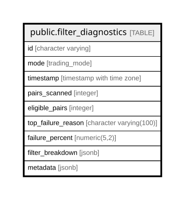

# public.filter_diagnostics

## Columns

| Name | Type | Default | Nullable | Children | Parents | Comment |
| ---- | ---- | ------- | -------- | -------- | ------- | ------- |
| id | character varying | gen_random_uuid() | false |  |  |  |
| mode | trading_mode |  | false |  |  |  |
| timestamp | timestamp with time zone | now() | true |  |  |  |
| pairs_scanned | integer | 0 | false |  |  |  |
| eligible_pairs | integer | 0 | false |  |  |  |
| top_failure_reason | character varying(100) |  | true |  |  |  |
| failure_percent | numeric(5,2) |  | true |  |  |  |
| filter_breakdown | jsonb |  | true |  |  |  |
| metadata | jsonb |  | true |  |  |  |

## Viewpoints

| Name | Definition |
| ---- | ---------- |
| [public schema](viewpoint-schema-public.md) | All mapped relations in public. |

## Constraints

| Name | Type | Definition |
| ---- | ---- | ---------- |
| filter_diagnostics_pkey | PRIMARY KEY | PRIMARY KEY (id) |

## Indexes

| Name | Definition |
| ---- | ---------- |
| filter_diagnostics_pkey | CREATE UNIQUE INDEX filter_diagnostics_pkey ON public.filter_diagnostics USING btree (id) |

## Relations

---

> Generated by [tbls](https://github.com/k1LoW/tbls)
