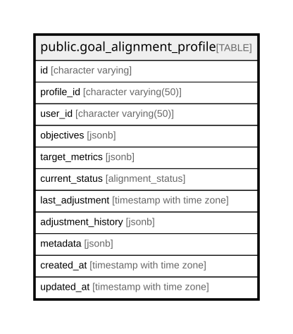

# public.goal_alignment_profile

## Columns

| Name | Type | Default | Nullable | Children | Parents | Comment |
| ---- | ---- | ------- | -------- | -------- | ------- | ------- |
| id | character varying | gen_random_uuid() | false |  |  |  |
| profile_id | character varying(50) |  | false |  |  |  |
| user_id | character varying(50) |  | true |  |  |  |
| objectives | jsonb |  | false |  |  |  |
| target_metrics | jsonb |  | false |  |  |  |
| current_status | alignment_status | 'compliant'::alignment_status | false |  |  |  |
| last_adjustment | timestamp with time zone |  | true |  |  |  |
| adjustment_history | jsonb |  | true |  |  |  |
| metadata | jsonb |  | true |  |  |  |
| created_at | timestamp with time zone | now() | false |  |  |  |
| updated_at | timestamp with time zone | now() | false |  |  |  |

## Viewpoints

| Name | Definition |
| ---- | ---------- |
| [public schema](viewpoint-schema-public.md) | All mapped relations in public. |

## Constraints

| Name | Type | Definition |
| ---- | ---- | ---------- |
| goal_alignment_profile_pkey | PRIMARY KEY | PRIMARY KEY (id) |
| goal_alignment_profile_profile_id_unique | UNIQUE | UNIQUE (profile_id) |

## Indexes

| Name | Definition |
| ---- | ---------- |
| goal_alignment_profile_current_status_idx | CREATE INDEX goal_alignment_profile_current_status_idx ON public.goal_alignment_profile USING btree (current_status) |
| goal_alignment_profile_pkey | CREATE UNIQUE INDEX goal_alignment_profile_pkey ON public.goal_alignment_profile USING btree (id) |
| goal_alignment_profile_profile_id_idx | CREATE INDEX goal_alignment_profile_profile_id_idx ON public.goal_alignment_profile USING btree (profile_id) |
| goal_alignment_profile_profile_id_unique | CREATE UNIQUE INDEX goal_alignment_profile_profile_id_unique ON public.goal_alignment_profile USING btree (profile_id) |
| goal_alignment_profile_user_id_idx | CREATE INDEX goal_alignment_profile_user_id_idx ON public.goal_alignment_profile USING btree (user_id) |

## Relations

---

> Generated by [tbls](https://github.com/k1LoW/tbls)
