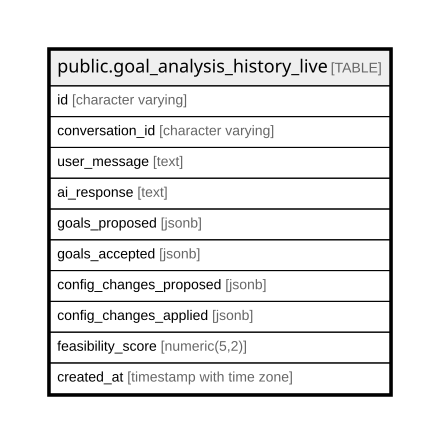

# public.goal_analysis_history_live

## Columns

| Name | Type | Default | Nullable | Children | Parents | Comment |
| ---- | ---- | ------- | -------- | -------- | ------- | ------- |
| id | character varying | gen_random_uuid() | false |  |  |  |
| conversation_id | character varying |  | true |  |  |  |
| user_message | text |  | true |  |  |  |
| ai_response | text |  | true |  |  |  |
| goals_proposed | jsonb |  | true |  |  |  |
| goals_accepted | jsonb |  | true |  |  |  |
| config_changes_proposed | jsonb |  | true |  |  |  |
| config_changes_applied | jsonb |  | true |  |  |  |
| feasibility_score | numeric(5,2) |  | true |  |  |  |
| created_at | timestamp with time zone | now() | true |  |  |  |

## Viewpoints

| Name | Definition |
| ---- | ---------- |
| [public schema](viewpoint-schema-public.md) | All mapped relations in public. |

## Constraints

| Name | Type | Definition |
| ---- | ---- | ---------- |
| goal_analysis_history_live_pkey | PRIMARY KEY | PRIMARY KEY (id) |

## Indexes

| Name | Definition |
| ---- | ---------- |
| goal_analysis_history_live_pkey | CREATE UNIQUE INDEX goal_analysis_history_live_pkey ON public.goal_analysis_history_live USING btree (id) |

## Relations

---

> Generated by [tbls](https://github.com/k1LoW/tbls)
