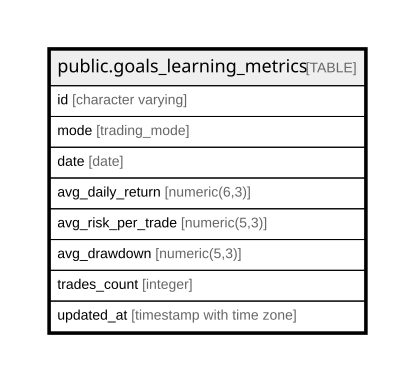

# public.goals_learning_metrics

## Columns

| Name | Type | Default | Nullable | Children | Parents | Comment |
| ---- | ---- | ------- | -------- | -------- | ------- | ------- |
| id | character varying | gen_random_uuid() | false |  |  |  |
| mode | trading_mode |  | false |  |  |  |
| date | date | CURRENT_DATE | false |  |  |  |
| avg_daily_return | numeric(6,3) |  | true |  |  |  |
| avg_risk_per_trade | numeric(5,3) |  | true |  |  |  |
| avg_drawdown | numeric(5,3) |  | true |  |  |  |
| trades_count | integer | 0 | true |  |  |  |
| updated_at | timestamp with time zone | now() | true |  |  |  |

## Viewpoints

| Name | Definition |
| ---- | ---------- |
| [public schema](viewpoint-schema-public.md) | All mapped relations in public. |

## Constraints

| Name | Type | Definition |
| ---- | ---- | ---------- |
| goals_learning_metrics_pkey | PRIMARY KEY | PRIMARY KEY (id) |

## Indexes

| Name | Definition |
| ---- | ---------- |
| goals_learning_metrics_pkey | CREATE UNIQUE INDEX goals_learning_metrics_pkey ON public.goals_learning_metrics USING btree (id) |
| goals_learning_mode_date_idx | CREATE INDEX goals_learning_mode_date_idx ON public.goals_learning_metrics USING btree (mode, date) |

## Relations

---

> Generated by [tbls](https://github.com/k1LoW/tbls)
