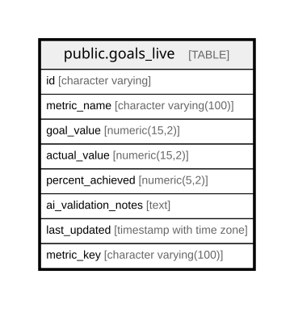

# public.goals_live

## Columns

| Name | Type | Default | Nullable | Children | Parents | Comment |
| ---- | ---- | ------- | -------- | -------- | ------- | ------- |
| id | character varying | gen_random_uuid() | false |  |  |  |
| metric_name | character varying(100) |  | false |  |  |  |
| goal_value | numeric(15,2) |  | true |  |  |  |
| actual_value | numeric(15,2) |  | true |  |  |  |
| percent_achieved | numeric(5,2) |  | true |  |  |  |
| ai_validation_notes | text |  | true |  |  |  |
| last_updated | timestamp with time zone | now() | true |  |  |  |
| metric_key | character varying(100) |  | false |  |  |  |

## Viewpoints

| Name | Definition |
| ---- | ---------- |
| [public schema](viewpoint-schema-public.md) | All mapped relations in public. |

## Constraints

| Name | Type | Definition |
| ---- | ---- | ---------- |
| user_goals_live_pkey | PRIMARY KEY | PRIMARY KEY (id) |

## Indexes

| Name | Definition |
| ---- | ---------- |
| user_goals_live_pkey | CREATE UNIQUE INDEX user_goals_live_pkey ON public.goals_live USING btree (id) |

## Relations

---

> Generated by [tbls](https://github.com/k1LoW/tbls)
