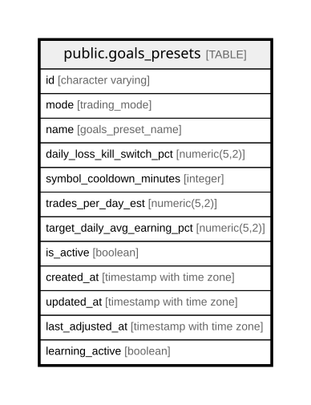

# public.goals_presets

## Columns

| Name | Type | Default | Nullable | Children | Parents | Comment |
| ---- | ---- | ------- | -------- | -------- | ------- | ------- |
| id | character varying | gen_random_uuid() | false |  |  |  |
| mode | trading_mode |  | false |  |  |  |
| name | goals_preset_name |  | false |  |  |  |
| daily_loss_kill_switch_pct | numeric(5,2) |  | false |  |  |  |
| symbol_cooldown_minutes | integer |  | false |  |  |  |
| trades_per_day_est | numeric(5,2) |  | false |  |  |  |
| target_daily_avg_earning_pct | numeric(5,2) |  | false |  |  |  |
| is_active | boolean | false | false |  |  |  |
| created_at | timestamp with time zone | now() | true |  |  |  |
| updated_at | timestamp with time zone | now() | true |  |  |  |
| last_adjusted_at | timestamp with time zone |  | true |  |  |  |
| learning_active | boolean | false | false |  |  |  |

## Viewpoints

| Name | Definition |
| ---- | ---------- |
| [public schema](viewpoint-schema-public.md) | All mapped relations in public. |

## Constraints

| Name | Type | Definition |
| ---- | ---- | ---------- |
| goals_presets_pkey | PRIMARY KEY | PRIMARY KEY (id) |

## Indexes

| Name | Definition |
| ---- | ---------- |
| goals_presets_mode_name_idx | CREATE UNIQUE INDEX goals_presets_mode_name_idx ON public.goals_presets USING btree (mode, name) |
| goals_presets_pkey | CREATE UNIQUE INDEX goals_presets_pkey ON public.goals_presets USING btree (id) |

## Relations

---

> Generated by [tbls](https://github.com/k1LoW/tbls)
