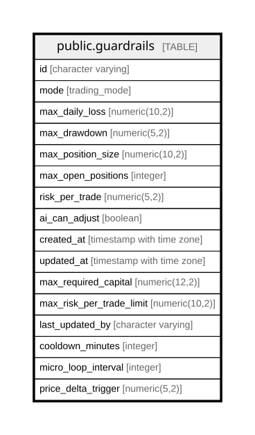

# public.guardrails

## Columns

| Name | Type | Default | Nullable | Children | Parents | Comment |
| ---- | ---- | ------- | -------- | -------- | ------- | ------- |
| id | character varying | gen_random_uuid() | false |  |  |  |
| mode | trading_mode |  | false |  |  |  |
| max_daily_loss | numeric(10,2) | 1000.00 | true |  |  |  |
| max_drawdown | numeric(5,2) | 10.00 | true |  |  |  |
| max_position_size | numeric(10,2) | 5000.00 | true |  |  |  |
| max_open_positions | integer | 5 | true |  |  |  |
| risk_per_trade | numeric(5,2) | 1.5 | true |  |  |  |
| ai_can_adjust | boolean | false | true |  |  |  |
| created_at | timestamp with time zone | now() | true |  |  |  |
| updated_at | timestamp with time zone | now() | true |  |  |  |
| max_required_capital | numeric(12,2) | 100000.00 | true |  |  |  |
| max_risk_per_trade_limit | numeric(10,2) | 1000.00 | true |  |  |  |
| last_updated_by | character varying |  | true |  |  |  |
| cooldown_minutes | integer | 15 | true |  |  |  |
| micro_loop_interval | integer | 8 | true |  |  |  |
| price_delta_trigger | numeric(5,2) | 0.30 | true |  |  |  |

## Viewpoints

| Name | Definition |
| ---- | ---------- |
| [public schema](viewpoint-schema-public.md) | All mapped relations in public. |

## Constraints

| Name | Type | Definition |
| ---- | ---- | ---------- |
| guardrails_mode_unique | UNIQUE | UNIQUE (mode) |
| guardrails_pkey | PRIMARY KEY | PRIMARY KEY (id) |

## Indexes

| Name | Definition |
| ---- | ---------- |
| guardrails_mode_unique | CREATE UNIQUE INDEX guardrails_mode_unique ON public.guardrails USING btree (mode) |
| guardrails_pkey | CREATE UNIQUE INDEX guardrails_pkey ON public.guardrails USING btree (id) |

## Relations

---

> Generated by [tbls](https://github.com/k1LoW/tbls)
