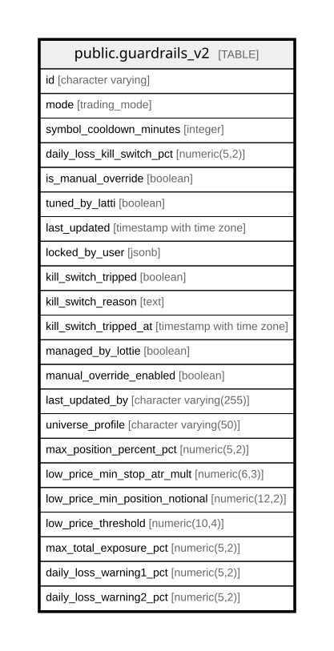

# public.guardrails_v2

## Columns

| Name | Type | Default | Nullable | Children | Parents | Comment |
| ---- | ---- | ------- | -------- | -------- | ------- | ------- |
| id | character varying | gen_random_uuid() | false |  |  |  |
| mode | trading_mode |  | false |  |  |  |
| symbol_cooldown_minutes | integer | 15 | false |  |  |  |
| daily_loss_kill_switch_pct | numeric(5,2) | 7.00 | false |  |  |  |
| is_manual_override | boolean | false | false |  |  |  |
| tuned_by_latti | boolean | true | false |  |  |  |
| last_updated | timestamp with time zone | now() | true |  |  |  |
| locked_by_user | jsonb | '{}'::jsonb | true |  |  |  |
| kill_switch_tripped | boolean | false | false |  |  |  |
| kill_switch_reason | text |  | true |  |  |  |
| kill_switch_tripped_at | timestamp with time zone |  | true |  |  |  |
| managed_by_lottie | boolean | true | false |  |  |  |
| manual_override_enabled | boolean | false | false |  |  |  |
| last_updated_by | character varying(255) |  | true |  |  |  |
| universe_profile | character varying(50) | 'TOP_100'::character varying | false |  |  |  |
| max_position_percent_pct | numeric(5,2) | 30.00 | false |  |  |  |
| low_price_min_stop_atr_mult | numeric(6,3) | 3.000 | false |  |  |  |
| low_price_min_position_notional | numeric(12,2) | 25.00 | false |  |  |  |
| low_price_threshold | numeric(10,4) | 0.5000 | false |  |  |  |
| max_total_exposure_pct | numeric(5,2) | 25.00 | false |  |  |  |
| daily_loss_warning1_pct | numeric(5,2) | 50.00 | false |  |  |  |
| daily_loss_warning2_pct | numeric(5,2) | 75.00 | false |  |  |  |

## Viewpoints

| Name | Definition |
| ---- | ---------- |
| [public schema](viewpoint-schema-public.md) | All mapped relations in public. |

## Constraints

| Name | Type | Definition |
| ---- | ---- | ---------- |
| guardrails_v2_check | CHECK | CHECK (NOT (is_manual_override AND tuned_by_latti)) |
| guardrails_v2_daily_loss_kill_switch_pct_check | CHECK | CHECK (daily_loss_kill_switch_pct >= 1.00 AND daily_loss_kill_switch_pct <= 20.00) |
| guardrails_v2_max_position_percent_pct_range | CHECK | CHECK (max_position_percent_pct > 0::numeric AND max_position_percent_pct <= 100::numeric) |
| guardrails_v2_max_total_exposure_pct_range | CHECK | CHECK (max_total_exposure_pct > 0::numeric AND max_total_exposure_pct <= 100::numeric) |
| guardrails_v2_pkey | PRIMARY KEY | PRIMARY KEY (id) |
| guardrails_v2_symbol_cooldown_minutes_check | CHECK | CHECK (symbol_cooldown_minutes >= 1) |

## Indexes

| Name | Definition |
| ---- | ---------- |
| guardrails_v2_mode_idx | CREATE UNIQUE INDEX guardrails_v2_mode_idx ON public.guardrails_v2 USING btree (mode) |
| guardrails_v2_pkey | CREATE UNIQUE INDEX guardrails_v2_pkey ON public.guardrails_v2 USING btree (id) |

## Relations

---

> Generated by [tbls](https://github.com/k1LoW/tbls)
