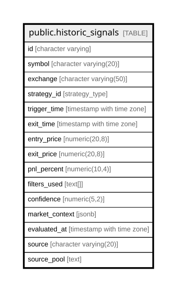

# public.historic_signals

## Columns

| Name | Type | Default | Nullable | Children | Parents | Comment |
| ---- | ---- | ------- | -------- | -------- | ------- | ------- |
| id | character varying | gen_random_uuid() | false |  |  |  |
| symbol | character varying(20) |  | false |  |  |  |
| exchange | character varying(50) | 'Kraken'::character varying | false |  |  |  |
| strategy_id | strategy_type |  | false |  |  |  |
| trigger_time | timestamp with time zone |  | false |  |  |  |
| exit_time | timestamp with time zone |  | true |  |  |  |
| entry_price | numeric(20,8) |  | false |  |  |  |
| exit_price | numeric(20,8) |  | true |  |  |  |
| pnl_percent | numeric(10,4) |  | true |  |  |  |
| filters_used | text[] |  | true |  |  |  |
| confidence | numeric(5,2) |  | true |  |  |  |
| market_context | jsonb |  | true |  |  |  |
| evaluated_at | timestamp with time zone | now() | true |  |  |  |
| source | character varying(20) | 'historic'::character varying | true |  |  |  |
| source_pool | text |  | true |  |  |  |

## Viewpoints

| Name | Definition |
| ---- | ---------- |
| [public schema](viewpoint-schema-public.md) | All mapped relations in public. |

## Constraints

| Name | Type | Definition |
| ---- | ---- | ---------- |
| historic_signals_pkey | PRIMARY KEY | PRIMARY KEY (id) |

## Indexes

| Name | Definition |
| ---- | ---------- |
| historic_signals_pkey | CREATE UNIQUE INDEX historic_signals_pkey ON public.historic_signals USING btree (id) |
| historic_signals_strategy_idx | CREATE INDEX historic_signals_strategy_idx ON public.historic_signals USING btree (strategy_id) |
| historic_signals_symbol_idx | CREATE INDEX historic_signals_symbol_idx ON public.historic_signals USING btree (symbol) |
| historic_signals_trigger_time_idx | CREATE INDEX historic_signals_trigger_time_idx ON public.historic_signals USING btree (trigger_time) |

## Relations

---

> Generated by [tbls](https://github.com/k1LoW/tbls)
