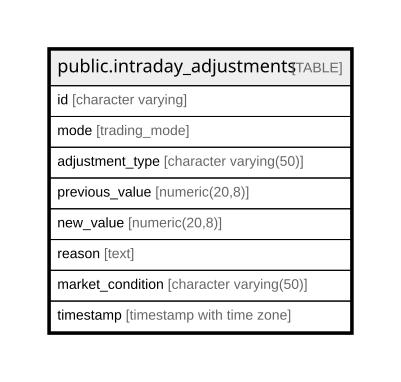

# public.intraday_adjustments

## Columns

| Name | Type | Default | Nullable | Children | Parents | Comment |
| ---- | ---- | ------- | -------- | -------- | ------- | ------- |
| id | character varying | gen_random_uuid() | false |  |  |  |
| mode | trading_mode |  | false |  |  |  |
| adjustment_type | character varying(50) |  | false |  |  |  |
| previous_value | numeric(20,8) |  | true |  |  |  |
| new_value | numeric(20,8) |  | true |  |  |  |
| reason | text |  | true |  |  |  |
| market_condition | character varying(50) |  | true |  |  |  |
| timestamp | timestamp with time zone | now() | true |  |  |  |

## Viewpoints

| Name | Definition |
| ---- | ---------- |
| [public schema](viewpoint-schema-public.md) | All mapped relations in public. |

## Constraints

| Name | Type | Definition |
| ---- | ---- | ---------- |
| intraday_adjustments_pkey | PRIMARY KEY | PRIMARY KEY (id) |

## Indexes

| Name | Definition |
| ---- | ---------- |
| intraday_adjustments_pkey | CREATE UNIQUE INDEX intraday_adjustments_pkey ON public.intraday_adjustments USING btree (id) |

## Relations

---

> Generated by [tbls](https://github.com/k1LoW/tbls)
