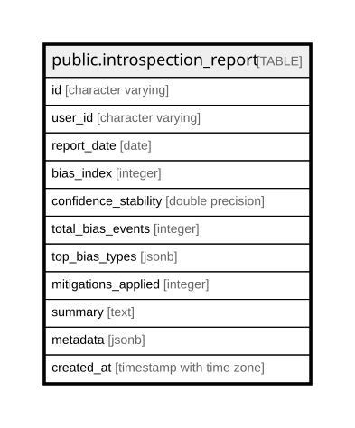

# public.introspection_report

## Columns

| Name | Type | Default | Nullable | Children | Parents | Comment |
| ---- | ---- | ------- | -------- | -------- | ------- | ------- |
| id | character varying | gen_random_uuid() | false |  |  |  |
| user_id | character varying |  | true |  |  |  |
| report_date | date |  | false |  |  |  |
| bias_index | integer |  | false |  |  |  |
| confidence_stability | double precision |  | false |  |  |  |
| total_bias_events | integer |  | false |  |  |  |
| top_bias_types | jsonb |  | false |  |  |  |
| mitigations_applied | integer |  | false |  |  |  |
| summary | text |  | true |  |  |  |
| metadata | jsonb |  | true |  |  |  |
| created_at | timestamp with time zone | now() | false |  |  |  |

## Viewpoints

| Name | Definition |
| ---- | ---------- |
| [public schema](viewpoint-schema-public.md) | All mapped relations in public. |

## Constraints

| Name | Type | Definition |
| ---- | ---- | ---------- |
| introspection_report_pkey | PRIMARY KEY | PRIMARY KEY (id) |

## Indexes

| Name | Definition |
| ---- | ---------- |
| introspection_report_created_at_idx | CREATE INDEX introspection_report_created_at_idx ON public.introspection_report USING btree (created_at) |
| introspection_report_pkey | CREATE UNIQUE INDEX introspection_report_pkey ON public.introspection_report USING btree (id) |
| introspection_report_report_date_idx | CREATE INDEX introspection_report_report_date_idx ON public.introspection_report USING btree (report_date) |
| introspection_report_user_id_idx | CREATE INDEX introspection_report_user_id_idx ON public.introspection_report USING btree (user_id) |

## Relations

---

> Generated by [tbls](https://github.com/k1LoW/tbls)
