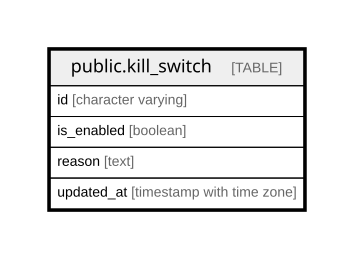

# public.kill_switch

## Columns

| Name | Type | Default | Nullable | Children | Parents | Comment |
| ---- | ---- | ------- | -------- | -------- | ------- | ------- |
| id | character varying | 'global_kill_switch'::character varying | false |  |  |  |
| is_enabled | boolean | false | false |  |  |  |
| reason | text |  | true |  |  |  |
| updated_at | timestamp with time zone | now() | false |  |  |  |

## Viewpoints

| Name | Definition |
| ---- | ---------- |
| [public schema](viewpoint-schema-public.md) | All mapped relations in public. |

## Constraints

| Name | Type | Definition |
| ---- | ---- | ---------- |
| kill_switch_pkey | PRIMARY KEY | PRIMARY KEY (id) |

## Indexes

| Name | Definition |
| ---- | ---------- |
| kill_switch_pkey | CREATE UNIQUE INDEX kill_switch_pkey ON public.kill_switch USING btree (id) |

## Relations

---

> Generated by [tbls](https://github.com/k1LoW/tbls)
