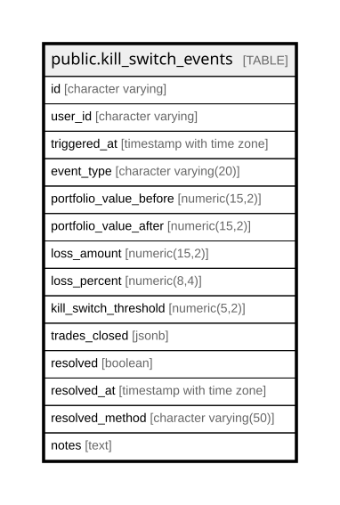

# public.kill_switch_events

## Columns

| Name | Type | Default | Nullable | Children | Parents | Comment |
| ---- | ---- | ------- | -------- | -------- | ------- | ------- |
| id | character varying | gen_random_uuid() | false |  |  |  |
| user_id | character varying |  | false |  |  |  |
| triggered_at | timestamp with time zone | now() | true |  |  |  |
| event_type | character varying(20) |  | false |  |  |  |
| portfolio_value_before | numeric(15,2) |  | false |  |  |  |
| portfolio_value_after | numeric(15,2) |  | false |  |  |  |
| loss_amount | numeric(15,2) |  | false |  |  |  |
| loss_percent | numeric(8,4) |  | false |  |  |  |
| kill_switch_threshold | numeric(5,2) |  | false |  |  |  |
| trades_closed | jsonb |  | true |  |  |  |
| resolved | boolean | false | true |  |  |  |
| resolved_at | timestamp with time zone |  | true |  |  |  |
| resolved_method | character varying(50) |  | true |  |  |  |
| notes | text |  | true |  |  |  |

## Viewpoints

| Name | Definition |
| ---- | ---------- |
| [public schema](viewpoint-schema-public.md) | All mapped relations in public. |

## Constraints

| Name | Type | Definition |
| ---- | ---- | ---------- |
| kill_switch_events_pkey | PRIMARY KEY | PRIMARY KEY (id) |

## Indexes

| Name | Definition |
| ---- | ---------- |
| kill_switch_events_pkey | CREATE UNIQUE INDEX kill_switch_events_pkey ON public.kill_switch_events USING btree (id) |

## Relations

---

> Generated by [tbls](https://github.com/k1LoW/tbls)
