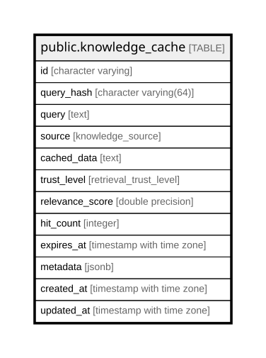

# public.knowledge_cache

## Columns

| Name | Type | Default | Nullable | Children | Parents | Comment |
| ---- | ---- | ------- | -------- | -------- | ------- | ------- |
| id | character varying | gen_random_uuid() | false |  |  |  |
| query_hash | character varying(64) |  | false |  |  |  |
| query | text |  | false |  |  |  |
| source | knowledge_source |  | false |  |  |  |
| cached_data | text |  | false |  |  |  |
| trust_level | retrieval_trust_level |  | false |  |  |  |
| relevance_score | double precision |  | true |  |  |  |
| hit_count | integer | 0 | false |  |  |  |
| expires_at | timestamp with time zone |  | false |  |  |  |
| metadata | jsonb |  | true |  |  |  |
| created_at | timestamp with time zone | now() | false |  |  |  |
| updated_at | timestamp with time zone | now() | false |  |  |  |

## Viewpoints

| Name | Definition |
| ---- | ---------- |
| [public schema](viewpoint-schema-public.md) | All mapped relations in public. |

## Constraints

| Name | Type | Definition |
| ---- | ---- | ---------- |
| knowledge_cache_pkey | PRIMARY KEY | PRIMARY KEY (id) |
| knowledge_cache_query_hash_key | UNIQUE | UNIQUE (query_hash) |

## Indexes

| Name | Definition |
| ---- | ---------- |
| knowledge_cache_expires_at_idx | CREATE INDEX knowledge_cache_expires_at_idx ON public.knowledge_cache USING btree (expires_at) |
| knowledge_cache_pkey | CREATE UNIQUE INDEX knowledge_cache_pkey ON public.knowledge_cache USING btree (id) |
| knowledge_cache_query_hash_idx | CREATE INDEX knowledge_cache_query_hash_idx ON public.knowledge_cache USING btree (query_hash) |
| knowledge_cache_query_hash_key | CREATE UNIQUE INDEX knowledge_cache_query_hash_key ON public.knowledge_cache USING btree (query_hash) |
| knowledge_cache_source_idx | CREATE INDEX knowledge_cache_source_idx ON public.knowledge_cache USING btree (source) |

## Relations

---

> Generated by [tbls](https://github.com/k1LoW/tbls)
