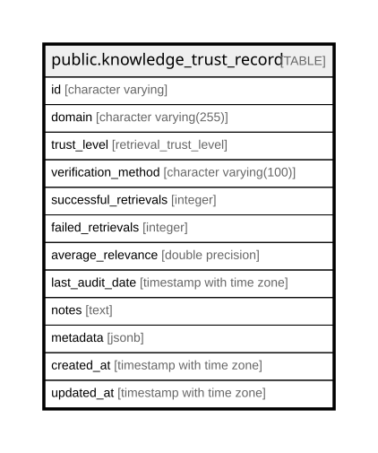

# public.knowledge_trust_record

## Columns

| Name | Type | Default | Nullable | Children | Parents | Comment |
| ---- | ---- | ------- | -------- | -------- | ------- | ------- |
| id | character varying | gen_random_uuid() | false |  |  |  |
| domain | character varying(255) |  | false |  |  |  |
| trust_level | retrieval_trust_level |  | false |  |  |  |
| verification_method | character varying(100) |  | true |  |  |  |
| successful_retrievals | integer | 0 | false |  |  |  |
| failed_retrievals | integer | 0 | false |  |  |  |
| average_relevance | double precision |  | true |  |  |  |
| last_audit_date | timestamp with time zone |  | true |  |  |  |
| notes | text |  | true |  |  |  |
| metadata | jsonb |  | true |  |  |  |
| created_at | timestamp with time zone | now() | false |  |  |  |
| updated_at | timestamp with time zone | now() | false |  |  |  |

## Viewpoints

| Name | Definition |
| ---- | ---------- |
| [public schema](viewpoint-schema-public.md) | All mapped relations in public. |

## Constraints

| Name | Type | Definition |
| ---- | ---- | ---------- |
| knowledge_trust_record_domain_key | UNIQUE | UNIQUE (domain) |
| knowledge_trust_record_pkey | PRIMARY KEY | PRIMARY KEY (id) |

## Indexes

| Name | Definition |
| ---- | ---------- |
| knowledge_trust_record_domain_idx | CREATE INDEX knowledge_trust_record_domain_idx ON public.knowledge_trust_record USING btree (domain) |
| knowledge_trust_record_domain_key | CREATE UNIQUE INDEX knowledge_trust_record_domain_key ON public.knowledge_trust_record USING btree (domain) |
| knowledge_trust_record_last_audit_date_idx | CREATE INDEX knowledge_trust_record_last_audit_date_idx ON public.knowledge_trust_record USING btree (last_audit_date) |
| knowledge_trust_record_pkey | CREATE UNIQUE INDEX knowledge_trust_record_pkey ON public.knowledge_trust_record USING btree (id) |
| knowledge_trust_record_trust_level_idx | CREATE INDEX knowledge_trust_record_trust_level_idx ON public.knowledge_trust_record USING btree (trust_level) |

## Relations

---

> Generated by [tbls](https://github.com/k1LoW/tbls)
