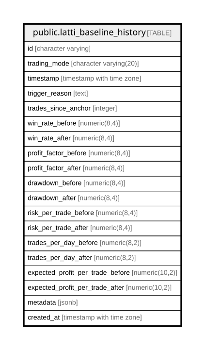

# public.latti_baseline_history

## Columns

| Name | Type | Default | Nullable | Children | Parents | Comment |
| ---- | ---- | ------- | -------- | -------- | ------- | ------- |
| id | character varying | gen_random_uuid() | false |  |  |  |
| trading_mode | character varying(20) |  | false |  |  |  |
| timestamp | timestamp with time zone | now() | true |  |  |  |
| trigger_reason | text |  | false |  |  |  |
| trades_since_anchor | integer |  | true |  |  |  |
| win_rate_before | numeric(8,4) |  | true |  |  |  |
| win_rate_after | numeric(8,4) |  | true |  |  |  |
| profit_factor_before | numeric(8,4) |  | true |  |  |  |
| profit_factor_after | numeric(8,4) |  | true |  |  |  |
| drawdown_before | numeric(8,4) |  | true |  |  |  |
| drawdown_after | numeric(8,4) |  | true |  |  |  |
| risk_per_trade_before | numeric(8,4) |  | true |  |  |  |
| risk_per_trade_after | numeric(8,4) |  | true |  |  |  |
| trades_per_day_before | numeric(8,2) |  | true |  |  |  |
| trades_per_day_after | numeric(8,2) |  | true |  |  |  |
| expected_profit_per_trade_before | numeric(10,2) |  | true |  |  |  |
| expected_profit_per_trade_after | numeric(10,2) |  | true |  |  |  |
| metadata | jsonb | '{}'::jsonb | true |  |  |  |
| created_at | timestamp with time zone | now() | true |  |  |  |

## Viewpoints

| Name | Definition |
| ---- | ---------- |
| [public schema](viewpoint-schema-public.md) | All mapped relations in public. |

## Constraints

| Name | Type | Definition |
| ---- | ---- | ---------- |
| latti_baseline_history_pkey | PRIMARY KEY | PRIMARY KEY (id) |

## Indexes

| Name | Definition |
| ---- | ---------- |
| latti_baseline_history_pkey | CREATE UNIQUE INDEX latti_baseline_history_pkey ON public.latti_baseline_history USING btree (id) |
| latti_baseline_history_timestamp_idx | CREATE INDEX latti_baseline_history_timestamp_idx ON public.latti_baseline_history USING btree ("timestamp") |
| latti_baseline_history_trading_mode_idx | CREATE INDEX latti_baseline_history_trading_mode_idx ON public.latti_baseline_history USING btree (trading_mode) |

## Relations

---

> Generated by [tbls](https://github.com/k1LoW/tbls)
