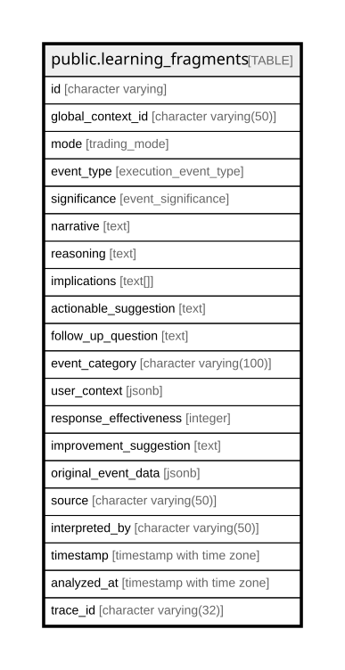

# public.learning_fragments

## Columns

| Name | Type | Default | Nullable | Children | Parents | Comment |
| ---- | ---- | ------- | -------- | -------- | ------- | ------- |
| id | character varying | gen_random_uuid() | false |  |  |  |
| global_context_id | character varying(50) | 'default'::character varying | false |  |  |  |
| mode | trading_mode |  | false |  |  |  |
| event_type | execution_event_type |  | false |  |  |  |
| significance | event_significance |  | false |  |  |  |
| narrative | text |  | false |  |  |  |
| reasoning | text |  | true |  |  |  |
| implications | text[] |  | true |  |  |  |
| actionable_suggestion | text |  | true |  |  |  |
| follow_up_question | text |  | true |  |  |  |
| event_category | character varying(100) |  | true |  |  |  |
| user_context | jsonb |  | true |  |  |  |
| response_effectiveness | integer |  | true |  |  |  |
| improvement_suggestion | text |  | true |  |  |  |
| original_event_data | jsonb |  | false |  |  |  |
| source | character varying(50) | 'ExecutionCore'::character varying | false |  |  |  |
| interpreted_by | character varying(50) | 'CognitiveLayer'::character varying | false |  |  |  |
| timestamp | timestamp with time zone | now() | true |  |  |  |
| analyzed_at | timestamp with time zone |  | true |  |  |  |
| trace_id | character varying(32) |  | true |  |  |  |

## Viewpoints

| Name | Definition |
| ---- | ---------- |
| [public schema](viewpoint-schema-public.md) | All mapped relations in public. |

## Constraints

| Name | Type | Definition |
| ---- | ---- | ---------- |
| learning_fragments_pkey | PRIMARY KEY | PRIMARY KEY (id) |

## Indexes

| Name | Definition |
| ---- | ---------- |
| learning_fragments_category_idx | CREATE INDEX learning_fragments_category_idx ON public.learning_fragments USING btree (event_category) |
| learning_fragments_context_mode_idx | CREATE INDEX learning_fragments_context_mode_idx ON public.learning_fragments USING btree (global_context_id, mode) |
| learning_fragments_event_type_idx | CREATE INDEX learning_fragments_event_type_idx ON public.learning_fragments USING btree (event_type) |
| learning_fragments_pkey | CREATE UNIQUE INDEX learning_fragments_pkey ON public.learning_fragments USING btree (id) |
| learning_fragments_significance_idx | CREATE INDEX learning_fragments_significance_idx ON public.learning_fragments USING btree (significance) |
| learning_fragments_timestamp_idx | CREATE INDEX learning_fragments_timestamp_idx ON public.learning_fragments USING btree ("timestamp") |

## Relations

---

> Generated by [tbls](https://github.com/k1LoW/tbls)
