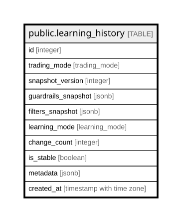

# public.learning_history

## Columns

| Name | Type | Default | Nullable | Children | Parents | Comment |
| ---- | ---- | ------- | -------- | -------- | ------- | ------- |
| id | integer | nextval('learning_history_id_seq'::regclass) | false |  |  |  |
| trading_mode | trading_mode |  | false |  |  |  |
| snapshot_version | integer |  | false |  |  |  |
| guardrails_snapshot | jsonb |  | false |  |  |  |
| filters_snapshot | jsonb |  | false |  |  |  |
| learning_mode | learning_mode |  | false |  |  |  |
| change_count | integer | 0 | false |  |  |  |
| is_stable | boolean | true | false |  |  |  |
| metadata | jsonb |  | true |  |  |  |
| created_at | timestamp with time zone | now() | false |  |  |  |

## Viewpoints

| Name | Definition |
| ---- | ---------- |
| [public schema](viewpoint-schema-public.md) | All mapped relations in public. |

## Constraints

| Name | Type | Definition |
| ---- | ---- | ---------- |
| learning_history_pkey | PRIMARY KEY | PRIMARY KEY (id) |

## Indexes

| Name | Definition |
| ---- | ---------- |
| learning_history_created_at_idx | CREATE INDEX learning_history_created_at_idx ON public.learning_history USING btree (created_at) |
| learning_history_mode_idx | CREATE INDEX learning_history_mode_idx ON public.learning_history USING btree (trading_mode) |
| learning_history_pkey | CREATE UNIQUE INDEX learning_history_pkey ON public.learning_history USING btree (id) |
| learning_history_stable_idx | CREATE INDEX learning_history_stable_idx ON public.learning_history USING btree (is_stable) |
| learning_history_version_idx | CREATE INDEX learning_history_version_idx ON public.learning_history USING btree (snapshot_version) |

## Relations

---

> Generated by [tbls](https://github.com/k1LoW/tbls)
