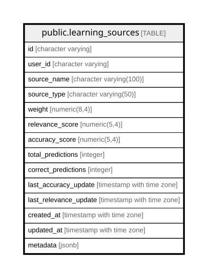

# public.learning_sources

## Columns

| Name | Type | Default | Nullable | Children | Parents | Comment |
| ---- | ---- | ------- | -------- | -------- | ------- | ------- |
| id | character varying | gen_random_uuid() | false |  |  |  |
| user_id | character varying |  | false |  |  |  |
| source_name | character varying(100) |  | false |  |  |  |
| source_type | character varying(50) |  | false |  |  |  |
| weight | numeric(8,4) | 1.0000 | true |  |  |  |
| relevance_score | numeric(5,4) | 0.5000 | true |  |  |  |
| accuracy_score | numeric(5,4) | 0.5000 | true |  |  |  |
| total_predictions | integer | 0 | true |  |  |  |
| correct_predictions | integer | 0 | true |  |  |  |
| last_accuracy_update | timestamp with time zone |  | true |  |  |  |
| last_relevance_update | timestamp with time zone |  | true |  |  |  |
| created_at | timestamp with time zone | now() | true |  |  |  |
| updated_at | timestamp with time zone | now() | true |  |  |  |
| metadata | jsonb |  | true |  |  |  |

## Viewpoints

| Name | Definition |
| ---- | ---------- |
| [public schema](viewpoint-schema-public.md) | All mapped relations in public. |

## Constraints

| Name | Type | Definition |
| ---- | ---- | ---------- |
| learning_sources_pkey | PRIMARY KEY | PRIMARY KEY (id) |

## Indexes

| Name | Definition |
| ---- | ---------- |
| learning_sources_pkey | CREATE UNIQUE INDEX learning_sources_pkey ON public.learning_sources USING btree (id) |
| learning_sources_user_source_idx | CREATE UNIQUE INDEX learning_sources_user_source_idx ON public.learning_sources USING btree (user_id, source_name) |

## Relations

---

> Generated by [tbls](https://github.com/k1LoW/tbls)
