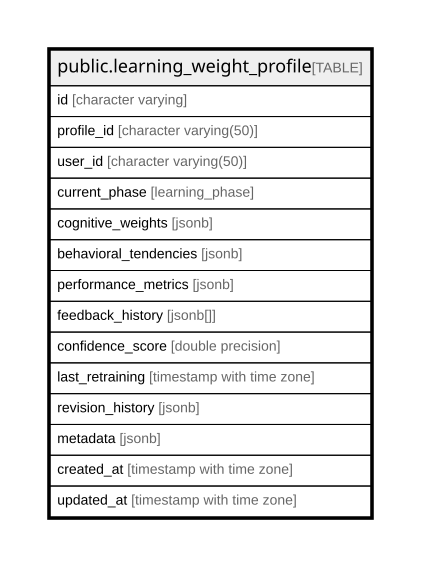

# public.learning_weight_profile

## Columns

| Name | Type | Default | Nullable | Children | Parents | Comment |
| ---- | ---- | ------- | -------- | -------- | ------- | ------- |
| id | character varying | gen_random_uuid() | false |  |  |  |
| profile_id | character varying(50) |  | false |  |  |  |
| user_id | character varying(50) |  | true |  |  |  |
| current_phase | learning_phase | 'observation'::learning_phase | false |  |  |  |
| cognitive_weights | jsonb |  | false |  |  |  |
| behavioral_tendencies | jsonb | '{}'::jsonb | false |  |  |  |
| performance_metrics | jsonb | '{}'::jsonb | false |  |  |  |
| feedback_history | jsonb[] | ARRAY[]::jsonb[] | true |  |  |  |
| confidence_score | double precision | 0.5 | true |  |  |  |
| last_retraining | timestamp with time zone |  | true |  |  |  |
| revision_history | jsonb |  | true |  |  |  |
| metadata | jsonb |  | true |  |  |  |
| created_at | timestamp with time zone | now() | false |  |  |  |
| updated_at | timestamp with time zone | now() | false |  |  |  |

## Viewpoints

| Name | Definition |
| ---- | ---------- |
| [public schema](viewpoint-schema-public.md) | All mapped relations in public. |

## Constraints

| Name | Type | Definition |
| ---- | ---- | ---------- |
| learning_weight_profile_pkey | PRIMARY KEY | PRIMARY KEY (id) |
| learning_weight_profile_profile_id_unique | UNIQUE | UNIQUE (profile_id) |

## Indexes

| Name | Definition |
| ---- | ---------- |
| learning_weight_profile_current_phase_idx | CREATE INDEX learning_weight_profile_current_phase_idx ON public.learning_weight_profile USING btree (current_phase) |
| learning_weight_profile_pkey | CREATE UNIQUE INDEX learning_weight_profile_pkey ON public.learning_weight_profile USING btree (id) |
| learning_weight_profile_profile_id_idx | CREATE INDEX learning_weight_profile_profile_id_idx ON public.learning_weight_profile USING btree (profile_id) |
| learning_weight_profile_profile_id_unique | CREATE UNIQUE INDEX learning_weight_profile_profile_id_unique ON public.learning_weight_profile USING btree (profile_id) |
| learning_weight_profile_user_id_idx | CREATE INDEX learning_weight_profile_user_id_idx ON public.learning_weight_profile USING btree (user_id) |

## Relations

---

> Generated by [tbls](https://github.com/k1LoW/tbls)
